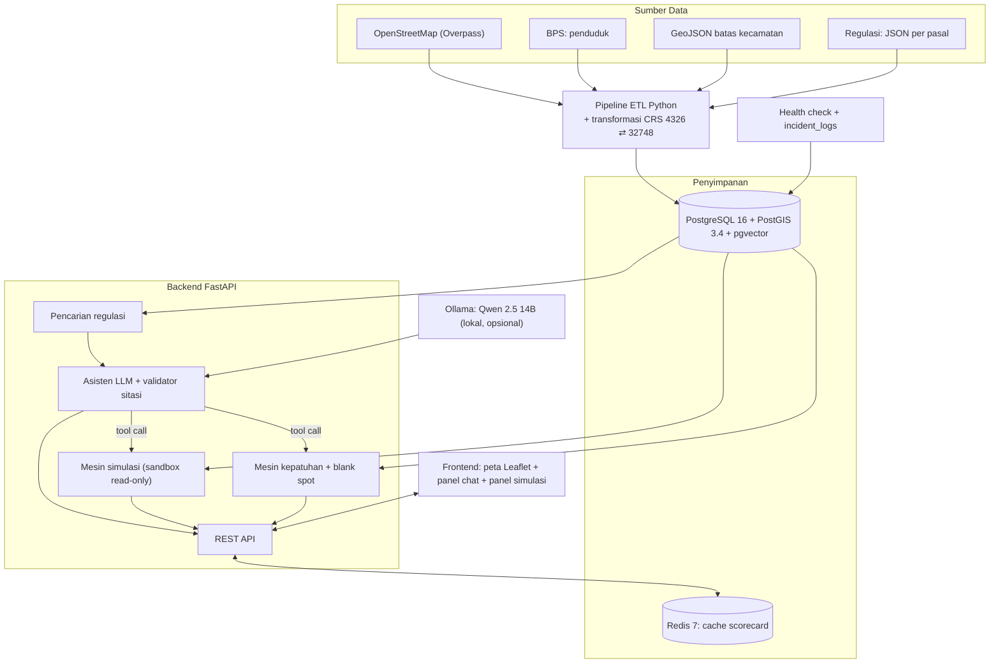
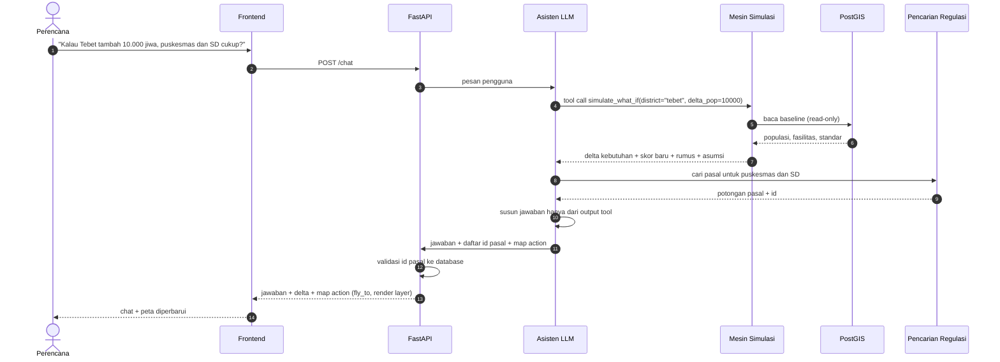

# District Resource Profiling
### DKI Jakarta - 44 Kecamatan

> Alat bantu perencana kota untuk (1) mengecek kecukupan fasilitas publik di 44 kecamatan DKI Jakarta terhadap SNI 03-1733-2004 dan regulasi terkait, dan (2) menghitung dampak pertambahan penduduk **sebelum** sebuah proyek dibangun. Semua angka dihitung oleh mesin spasial yang dapat diaudit. LLM lokal hanya menerjemahkan pertanyaan, memanggil fungsi, dan mengutip pasal.

*Proyek Mata Kuliah Rekayasa Perangkat Lunak (ENCE605024), Semester 5, Fakultas Teknik Universitas Indonesia. Kelompok 1.*

---

## Daftar Isi
1. [Masalah](#1-masalah)
2. [Solusi dan Prinsip Desain](#2-solusi-dan-prinsip-desain)
3. [Pengguna dan Use Case](#3-pengguna-dan-use-case)
4. [Ruang Lingkup](#4-ruang-lingkup)
5. [Fitur: MVP dan Lanjutan](#5-fitur-mvp-dan-lanjutan) (lihat juga §5.1 Status Implementasi)
6. [Jenis Fasilitas yang Dinilai dan Standarnya](#6-jenis-fasilitas-yang-dinilai-dan-standarnya)
7. [Sumber Data](#7-sumber-data)
8. [Model Perhitungan](#8-model-perhitungan)
9. [Arsitektur](#9-arsitektur)
10. [Alur Chat dan Simulasi](#10-alur-chat-dan-simulasi)
11. [Guardrail dan Evaluasi AI](#11-guardrail-dan-evaluasi-ai)
12. [Monitoring](#12-monitoring)
13. [Ringkasan API](#13-ringkasan-api)
14. [Keterbatasan](#14-keterbatasan)
15. [Kebutuhan Sistem](#15-kebutuhan-sistem)
16. [Menjalankan Proyek](#16-menjalankan-proyek)
17. [Pengujian](#17-pengujian)
18. [Struktur Repositori](#18-struktur-repositori)
19. [Roadmap](#19-roadmap)
20. [Tim, Lisensi, dan Atribusi](#20-tim-lisensi-dan-atribusi)

---

## 1. Masalah

| Masalah | Yang terjadi hari ini | Akibat |
|---|---|---|
| **Data terpisah** | Penduduk (BPS), lokasi fasilitas (OpenStreetMap), dan aturan (JDIH/BSN) disimpan di tempat dan format berbeda. | Audit satu kecamatan butuh penggabungan manual. |
| **Tidak ada simulasi pra-konstruksi** | Saat ada rencana apartemen 4.500 unit di sebuah kecamatan, tidak ada cara cepat untuk melihat dampaknya ke puskesmas, SD, dan taman. | Kekurangan fasilitas baru ketahuan setelah penghuni pindah. |
| **LLM tidak bisa dipercaya untuk angka** | Chatbot biasa menebak rasio, jarak, dan nomor pasal. | Angka salah dan kutipan hukum karangan. |

---

## 2. Solusi dan Prinsip Desain

```
Pertanyaan ─► LLM lokal          : pahami pertanyaan, pilih fungsi, jelaskan hasil
                 │ tool call (JSON)
                 ▼
             Mesin deterministik : PostGIS + Python, semua angka dihitung di sini
                 │ angka + id pasal
                 ▼
             Validator sitasi    : pastikan setiap pasal yang dikutip ada di database
                 │
                 ▼
             Peta + jawaban chat
```

**Prinsip:**
1. **LLM tidak pernah menghitung.** Setiap angka di jawaban berasal dari output fungsi.
2. **Setiap angka bisa ditelusuri.** Input yang sama selalu menghasilkan angka yang sama, dan respons menyertakan rumus, asumsi, dan sumber datanya.
3. **Setiap kutipan hukum harus ada di database regulasi.** Kutipan yang tidak ditemukan dibuang dari jawaban.
4. **Simulasi tidak pernah mengubah data master.**
5. **On-premise.** Data dan inferensi tidak dikirim ke layanan cloud.
6. **Sistem tetap berguna tanpa LLM.** Peta, scorecard, dan simulasi jalan tanpa GPU.

---

## 3. Pengguna dan Use Case

| Persona | Kebutuhan | Kriteria penerimaan |
|---|---|---|
| **Utama: perencana / auditor tata ruang** (Bappeda, Dinas Cipta Karya) | Melihat kepatuhan fasilitas per kecamatan untuk memprioritaskan anggaran | Scorecard per pilar + defisit per jenis fasilitas yang dinilai (§6.2) tampil < 2 detik |
| **Utama: perencana** | Melihat area yang tidak terjangkau fasilitas | Peta menampilkan poligon blank spot, % cakupan, dan km² tidak terlayani |
| **Utama: auditor** | Memverifikasi dasar hukum setiap angka | Setiap kutipan menyebut dokumen, bab/pasal, dan ada di database |
| **Sekunder: pengembang properti** | Mengetahui kewajiban fasilitas dari proyek superblok | Hasil simulasi berisi tambahan penduduk, kebutuhan fasilitas tambahan, dan pasal rujukan, dengan label "hipotetis" |

---

## 4. Ruang Lingkup

| Dalam scope | Di luar scope |
|---|---|
| 44 kecamatan DKI Jakarta | Provinsi lain |
| 7 jenis fasilitas dinilai dalam 2 pilar (§6.2), ditambah jenis informasi (§6.3) | Kualitas layanan (tenaga medis, jam buka, akreditasi) |
| Kepatuhan rasio penduduk dan radius layanan | **Keputusan izin atau nasihat hukum** |
| Simulasi tambahan penduduk, superblok, dan fasilitas baru | Simulasi lalu lintas, banjir, atau ekonomi |
| Asisten chat dengan tool calling dan pencarian regulasi | Perubahan data master oleh AI |
| Deployment Docker Compose di satu mesin | Cloud atau multi-node |

---

## 5. Fitur: MVP dan Lanjutan

| Fitur | MVP | Lanjutan |
|---|---|---|
| Peta choropleth 44 kecamatan berdasarkan skor | ✅ | |
| Scorecard per pilar + defisit per jenis fasilitas yang dinilai | ✅ | |
| Blank spot per jenis fasilitas | ✅ | Memperhitungkan fasilitas lintas batas kecamatan |
| Simulasi tambahan penduduk | ✅ | |
| Simulasi superblok (kewajiban fasilitas) | ✅ | |
| Simulasi penempatan fasilitas baru | ✅ (MVP-partial: in-memory sandbox via simulate-reduction & staged_amenities) | |
| Pencarian regulasi per pasal | ✅ (leksikal) | Hybrid leksikal + embedding semantik |
| Chat dengan tool calling | ✅ (multi-ronde, maks 4 ronde, histori 6 turn) | |
| Peta bergerak mengikuti jawaban chat (fly-to, highlight) | ✅ | |
| Health check + incident log | ✅ | Notifikasi webhook |
| Aksesibilitas berbasis jaringan jalan | | ✅ |

---

## 5.1 Status Implementasi (freeze UTS, 15 Oktober 2026)

Tabel ini adalah status kode yang sebenarnya saat README dibekukan untuk UTS. Buku dan presentasi wajib memakai status ini, bukan kolom "MVP" di §5.

| Komponen | Status | Catatan |
|---|---|---|
| Peta choropleth + scorecard 7 standar (§6.2) | **[Implemented]** | Angka standar cocok dengan PDF SNI. Kolom "Dicek oleh" belum diisi tim |
| Data penduduk per kecamatan | **[Partial] `TODO-VERIFY`** | Nomor tabel BPS belum dicocokkan. Jumlah 44 kecamatan (10.964.460) berbeda 279.540 dari total provinsi di file yang sama. UI menampilkan peringatan |
| Klasifikasi fasilitas dari OSM | **[Partial]** | Tag OSM + pola nama. Presisi belum diukur; sampel 210 record menunggu label manusia (`pipeline/data/validation/`) |
| Blank spot lintas batas kecamatan | **[Implemented]** | Radius garis lurus, hanya fasilitas di dalam DKI. Pos damkar tanpa blank spot (SNI tidak memberi radius) |
| Simulasi tambahan penduduk (what-if) | **[Implemented]** | Ambang Rendah/Sedang/Tinggi masih `TODO-DECIDE` |
| Simulasi superblok | **[Partial]** | RTH 20%, retensi 150 mm/hari, KDB 50% adalah parameter asumsi; Perda 31/2022 belum diverifikasi |
| Simulasi fasilitas hipotetis (`simulate-reduction`) | **[Partial]** | Endpoint ada; belum masuk set evaluasi |
| Pencarian regulasi | **[Implemented] leksikal** | 11 pasal SNI yang cocok dengan PDF. Perda, Permenkes, Permendagri belum diverifikasi dan tidak diindeks. Embedding semantik `[Planned]` |
| Asisten chat (multi-ronde, guardrail angka, validator sitasi, penolakan izin) | **[Implemented]** | Set evaluasi 30 pertanyaan berstatus DRAFT, belum direview manusia |
| Health check, watchdog, incident log | **[Implemented]** | |
| Docker Compose satu perintah | **[Partial]** | Compose menyalakan database, cache, backend, watchdog dan membuat skema + 16 standar; data kecamatan, fasilitas dan regulasi dimuat terpisah dengan pipeline/boundary_loader.py dan pipeline/regulation_loader.py (§16) |
| CI GitHub Actions | **[Partial]** | Workflow `.github/workflows/tests.yml` menjalankan `pytest -m unit` pada setiap push / pull request (hasil run pertama dicek di tab Actions) |
| Keamanan | **[Partial]** | Port DB/Redis hanya localhost, `.dockerignore`, API key opsional. Trivy: paket OS 1 CRITICAL + 109 HIGH, paket Python 4 HIGH (belum diperbaiki) |
| Aksesibilitas jaringan jalan, notifikasi webhook | **[Planned]** | |

---

## 6. Jenis Fasilitas yang Dinilai dan Standarnya

### 6.1 Aturan masuk

Sebuah jenis fasilitas **dinilai** (punya kebutuhan, defisit, skor, dan blank spot) hanya jika memenuhi **semua** syarat:

1. **Standar terdokumentasi.** Angka "1 unit per N jiwa" (dan radius, bila dipakai untuk blank spot) diambil kata per kata dari dokumen yang salinannya disimpan di `pipeline/data/sources/`, lengkap dengan nomor tabel dan halaman.
2. **Dicek manusia.** Satu anggota tim membandingkan angka di tabel ini dengan PDF aslinya dan mengisi kolom "Dicek oleh".
3. **Klasifikasi memakai tag OSM + pola nama yang didokumentasikan di `OSM_TAG_MAPPING.md`. Presisinya diukur dari sampel berlabel manusia (`pipeline/data/validation/`); sebelum sampel diisi, presisi = TODO-VERIFY.**
4. **Lolos cek ketersediaan otomatis**: minimal 44 record terklasifikasi se-DKI (lihat §8).

Jenis yang gagal salah satu syarat **tidak pernah ditampilkan sebagai "defisit"**. Paling jauh ditampilkan sebagai jumlah titik OSM dengan label "tidak dinilai".

### 6.2 Dinilai (7 jenis, 2 pilar)

| Pilar | Jenis | 1 unit per | Radius | Sumber | Dicek oleh |
|---|---|---|---|---|---|
| Pendidikan | Taman Kanak-kanak | 1.250 jiwa | 500 m | SNI 03-1733-2004, Tabel 8, hal. 26 | `[NAMA]` |
| Pendidikan | Sekolah Dasar | 1.600 jiwa | 1.000 m | SNI 03-1733-2004, Tabel 8, hal. 26 | `[NAMA]` |
| Pendidikan | SMP (SNI: SLTP) | 4.800 jiwa | 1.000 m | SNI 03-1733-2004, Tabel 8, hal. 26 | `[NAMA]` |
| Pendidikan | SMA/SMK (SNI: SMU) | 4.800 jiwa | 3.000 m | SNI 03-1733-2004, Tabel 8, hal. 26 | `[NAMA]` |
| Kesehatan & Keselamatan | Puskesmas pembantu (kelurahan) | 30.000 jiwa | 1.500 m | SNI 03-1733-2004, Tabel 12, hal. 29 | `[NAMA]` |
| Kesehatan & Keselamatan | Puskesmas (kecamatan) | 120.000 jiwa | 3.000 m | SNI 03-1733-2004, Tabel 12, hal. 29 | `[NAMA]` |
| Kesehatan & Keselamatan | Pos pemadam kebakaran (tingkat kecamatan) | 120.000 jiwa | tidak ada di SNI, jadi tanpa blank spot | SNI 03-1733-2004, Tabel 6, hal. 23-24 | `[NAMA]` |

Catatan:
- **SMK disamakan dengan SMU.** Ini keputusan tim; SNI 2004 hanya menyebut SMU.
- **Pemetaan puskesmas di Jakarta.** Jakarta menyebut fasilitas tingkat kelurahan "Puskesmas Kelurahan", bukan "Puskesmas Pembantu". Penyamaan keduanya adalah keputusan tim (`TODO-DECIDE`).

### 6.3 Ditampilkan sebagai informasi saja (tidak dinilai)

| Jenis | Alasan tidak dinilai |
|---|---|
| Rumah sakit | Tidak ada di SNI 03-1733-2004, dan melayani lintas kecamatan |
| Posyandu | Ada di SNI (Tabel 12: 1.250 jiwa, 500 m), tetapi data OSM tidak representatif (contoh: Kelapa Gading hanya 1 titik) |
| Stasiun transit, halte TransJakarta | Tidak ada standar "1 unit per N jiwa". Hanya jumlah titik yang ditampilkan |
| Pasar | Ada di SNI bagian 7.5, tetapi barisnya belum diekstrak dari PDF (`TODO-VERIFY`) |
| Taman RT/RW/kelurahan/kecamatan | Ada di SNI bagian 7.7, tetapi OSM tidak membedakan tingkat taman |
| RPTRA | Tidak ada standar jumlah per penduduk yang terverifikasi |

### 6.4 Dihapus dari sistem

| Jenis | Alasan |
|---|---|
| TPS 3R | Tidak ada di SNI 03-1733-2004 (rujukan "Bab 5.7 Tabel 15" tidak ada). Klasifikasi OSM menebak dari kata "tps" |
| Hidran kebakaran | SNI 03-1733-2004 hanya merujuk standar hidran lain, tidak memberi angka |
| Hutan kota, gelanggang olahraga | Tidak ada di SNI 03-1733-2004 |
| Perpustakaan wilayah | Hanya 5 record OSM se-DKI. SNI hanya menyebut taman bacaan (2.500 jiwa) |
| Sentra niaga UMKM | Tidak ada standar dan 0 record OSM |
| Pos polisi | SNI hanya menyebut pos kamtib dan kantor polisi. Tag OSM `amenity=police` mencampur keduanya |

### 6.5 Bobot dan nama indeks

- **Bobot pilar adalah keputusan tim, bukan dari regulasi** (`TODO-DECIDE`): Kesehatan & Keselamatan 0,30 dan Pendidikan 0,25 (bobot awal), lalu diskalakan ulang ke pilar yang aktif (§8).
- **Nama indeks:** "Indeks Kecukupan Fasilitas Dasar". Bukan "Indeks Kelayakan Hidup", karena ruang hidup, mobilitas, dan kualitas lingkungan tidak diukur.

### 6.6 Sumber dokumen

| Dokumen | Salinan | Keterangan |
|---|---|---|
| SNI 03-1733-2004 *Tata cara perencanaan lingkungan perumahan di perkotaan* (BSN) | `pipeline/data/sources/README.md` (URL + SHA-256; PDF tidak disimpan di repo karena hak cipta BSN) | Salinan dari mirror tidak resmi. Tim wajib mencocokkan dengan salinan resmi BSN sebelum UAS |

Nomor bab di SNI ini adalah **Bab 7** (7.1 pemerintahan, 7.2 pendidikan, 7.3 kesehatan, 7.5 perdagangan, 7.7 ruang terbuka). Rujukan "Bab 5.x" di kode dan korpus lama **salah** dan harus diganti.

---


## 7. Sumber Data

| Data | Sumber | Format | Catatan |
|---|---|---|---|
| Batas 44 kecamatan | GeoJSON batas administrasi DKI | Poligon | Disimpan dalam SRID 4326 dan 32748 |
| Penduduk per kecamatan | BPS, *Kecamatan Dalam Angka* | Tabel | Cantumkan tahun dan nomor tabel. Kecamatan tanpa data ditandai "tidak tersedia", bukan diisi angka default. |
| Lokasi fasilitas | OpenStreetMap via Overpass API | Titik | Simpan `osm_id` asli dan tanggal snapshot |
| Teks regulasi | JDIH / BSN, dikurasi manual per pasal ke JSON | Teks terstruktur | Kurasi manual dipilih karena kutipan hukum harus tepat |

---

## 8. Model Perhitungan

**Kebutuhan dan defisit**
```
N_required = max(1, ceil(Populasi / Threshold))
Defisit    = N_existing - N_required
```

**Ketersediaan Data Fasilitas (Standards Availability)**
Setiap jenis fasilitas di §6.2 dievaluasi ketersediaan datanya di DKI Jakarta. Jenis yang tidak `available` tidak diberi kebutuhan, defisit, maupun skor:
- `available`: Memiliki $\ge 44$ rekaman terklasifikasi di DKI Jakarta (rata-rata $\ge 1$ per kecamatan).
- `insufficient`: Memiliki data namun $< 44$ rekaman (dianggap belum representatif untuk skor kota).
- `not_available`: Memiliki 0 rekaman atau tidak memiliki pemetaan tag OSM yang valid.

**Skor per jenis fasilitas** (dibatasi 100 agar surplus satu jenis tidak menutupi kekurangan jenis lain)
```
S_jenis = min(100, N_existing / N_required × 100)
S_pilar = rata-rata S_jenis yang berstatus 'available' dalam pilar
```

**Aturan Skor Komposit & Re-weighting Proporsional**
- Sebuah pilar **hanya dihitung dalam skor komposit jika memiliki $\ge 2$ jenis fasilitas** yang berstatus `available`.
- Pilar yang punya kurang dari 2 jenis `available` ditampilkan dengan status `cakupan data rendah`, **tanpa angka skor**, dan bobotnya 0 dalam komposit (`included_in_composite: false`).
- Bobot pilar aktif diskalakan ulang secara proporsional: `W'_i = W_i / jumlah W_k pilar aktif`.
- Contoh, jika kedua pilar aktif: Kesehatan & Keselamatan 0,30 / 0,55 = 54,5%, Pendidikan 0,25 / 0,55 = 45,5%.

**Tingkat Indikasi Dampak Simulasi (`TODO-DECIDE (team)`)**
Indikasi beban fasilitas pada simulasi What-If dan Superblok dievaluasi berbasis perubahan skor dan unit defisit baru:
- `Rendah`: $\Delta \text{skor} > -1.0$ DAN 0 unit defisit baru pada fasilitas `available`.
- `Tinggi`: $\Delta \text{skor} \le -5.0$ ATAU $\ge 3$ unit defisit baru pada fasilitas `available`.
- `Sedang`: Selain kondisi di atas.
*Catatan:* Nilai ambang batas (`-1.0`, `0`, `-5.0`, `3`) adalah parameter konfigurasi (`TODO-DECIDE (team)`) yang dapat dikalibrasi oleh tim perencana kota.

**Blank spot** (proyeksi UTM 48S, EPSG:32748)
```
blank_spot = ST_Difference(batas_kecamatan, ST_Union(ST_Buffer(fasilitas, radius)))
cakupan %  = (luas_kecamatan − luas_blank_spot) / luas_kecamatan × 100
```
Fasilitas dari kecamatan tetangga yang radius layanannya menjangkau batas kecamatan target turut diperhitungkan dalam buffer (`cross_border_scope: "DKI Jakarta only"`).

**Contoh:** kecamatan 120.000 jiwa dengan 3 puskesmas kelurahan memberi `N_required = 4`, `Defisit = −1`, dan `Skor = 75`.

---

## 9. Arsitektur



**Keputusan teknologi dan alasannya**

| Keputusan | Alasan |
|---|---|
| **Ollama** untuk serving LLM | Setup satu perintah, mendukung tool calling, cukup untuk satu pengguna demo. vLLM baru relevan untuk banyak pengguna bersamaan. |
| **Leaflet** untuk peta | 44 poligon dan beberapa ribu titik masih ringan untuk Leaflet. WebGL (MapLibre/Deck.gl) belum dibutuhkan. |
| **Regulasi dikurasi manual** | Korpusnya kecil (±5 dokumen), dan kutipan hukum harus tepat. OCR otomatis menambah risiko salah pasal. |
| **Tanpa fallback cloud** | Konsisten dengan prinsip on-premise. Jika LLM mati, sistem memakai ringkasan deterministik. |
| **Redis hanya untuk cache scorecard** | Dengan 44 kecamatan, cache spasial tambahan tidak memberi manfaat berarti. Penyimpanan cache otomatis untuk respons LLM berisiko mengembalikan jawaban yang salah konteks. |
| **Pencarian regulasi leksikal via pgvector** | Menggunakan trigram, hashed bag-of-words, dan sinonim yang dipetakan ke kolom pgvector; dense embedding model (`bge-m3` / `text-embedding-3-small`) ditunda. Alasannya: dependensi eksternal nol, tidak memerlukan GPU untuk ingestion korpus, dan sangat memadai untuk 11 potongan regulasi terverifikasi. |

---

## 10. Alur Chat dan Simulasi



**Contoh simulasi:** superblok 4.500 unit × 3 jiwa/unit = 13.500 jiwa baru.

```
ΔPuskesmas kelurahan = ceil(P_baru / 30.000) − ceil(P_lama / 30.000)
ΔSD                  = ceil(P_baru / 1.600)  − ceil(P_lama / 1.600)
```

Satu rumus delta dipakai untuk semua jenis fasilitas. Asumsi (jiwa per unit) ditampilkan di respons.

**Label output:** *"Indikasi dampak: Rendah / Sedang / Tinggi. Bukan keputusan perizinan; untuk bahan diskusi perencanaan."* Dasar ambang batas Rendah/Sedang/Tinggi didokumentasikan di konfigurasi.

---

## 11. Guardrail dan Evaluasi AI

**Guardrail**

| Risiko | Pengendalian |
|---|---|
| LLM mengarang angka | Prompt sistem melarang angka di luar output tool. Angka di jawaban dicocokkan dengan output tool. |
| LLM mengarang pasal | Validator sitasi membuang id pasal yang tidak ada di database. |
| Pertanyaan di luar scope (izin, nasihat hukum) | Asisten menolak dengan sopan dan menjelaskan batas scope. |
| LLM tidak tersedia | Fallback ke ringkasan deterministik dari output tool. |

**Evaluasi (Hasil Pengujian Riil 3-Run pada Qwen 2.5 14B)**

Hasil evaluasi otomatis menggunakan set uji 30 pertanyaan (`eval/ai_eval_set.json`) yang dijalankan sebanyak 3 kali (total 90 inferensi) terhadap Ollama lokal:

| Metrik | Cara ukur | Target (README §11) | Hasil Rerata (3 Run) | Status |
|---|---|---|---|---|
| **Ketepatan pemilihan tool** | Set uji 30 pertanyaan dengan tool yang diharapkan | $\ge 90\%$ | **100.0%** (min 100.0% - max 100.0%) | **PASS** |
| **Tingkat Error Sistem (Error Rate)** | Kegagalan eksekusi tak tertangani (exception/crash) | 0% | **0.0%** (min 0.0% - max 0.0%) | **PASS** |
| **Kebocoran angka jawaban final** | Angka tidak terverifikasi yang lolos ke jawaban final | 0 | **0.0** | **PASS** |
| **Sitasi jawaban final konsisten dengan korpus terverifikasi** | Sitasi tidak konsisten / tidak terverifikasi yang lolos ke jawaban final | 0 | **0.0** | **PASS** |
| **Akurasi penolakan scope** | Pertanyaan izin/nasihat hukum ditolak | $100\%$ | **100.0%** | **PASS** |
| **Capaian nilai yang diharapkan** | Kelengkapan nilai acuan spesifik pada respons | Dilaporkan apa adanya | **90.0%** (min 90.0% - max 90.0%) | Dilaporkan |
| **Angka raw tanpa sumber tertangkap** | Jumlah angka tidak berdasar pada raw LLM yang diblokir guardrail | Dilaporkan apa adanya | **1.0** | Dilaporkan |
| **Tingkat halusinasi sitasi raw** | Frekuensi raw LLM mencantumkan sitasi tak berdasar | Dilaporkan apa adanya | **52.2%** | Dilaporkan |
| **Tingkat Guardrail Fallback** | Frekuensi aktivasi ringkasan deterministik | Dilaporkan apa adanya | **10.0%** (min 6.7% - max 16.7%) | Dilaporkan |
| **Tingkat Guardrail Retry** | Frekuensi retry koreksi angka/label mandiri | Dilaporkan apa adanya | **1.1%** | Dilaporkan |
| **Latensi respons (p50 / p95)** | Waktu eksekusi inferensi AI end-to-end | Dilaporkan apa adanya | **8.69s / 22.70s** | Dilaporkan |

*Catatan Target Evaluasi:*
- **Kebocoran Angka (0.0 PASS):** Numeric guardrail secara konsisten memblokir seluruh angka tidak berdasar pada raw LLM dan mengalihkannya ke fallback deterministik sehingga tidak ada angka liar yang tembus ke pengguna.
- **Sitasi Konsisten dengan Korpus Terverifikasi (0.0 PASS):** Pembersihan sitasi pada validator sitasi secara ketat memvalidasi seluruh referensi pasal terhadap korpus dokumen terverifikasi (PDF-matched) dan membuang tag tidak valid atau tidak terverifikasi, mencapai target 0.0 kebocoran di jawaban final.

---

## 12. Monitoring

Cukup sederhana untuk skala satu mesin:
- **Health check** `/health`: status PostgreSQL, Redis, dan Ollama.
- **Incident log**: setiap kegagalan dicatat ke tabel `incident_logs`.
- **Notifikasi** (lanjutan): webhook Discord/Telegram satu arah.

Restart otomatis **tidak** dilakukan dari dalam aplikasi. Restart container adalah tanggung jawab Docker (`restart: unless-stopped`).

---

## 13. Ringkasan API

| Method | Endpoint | Fungsi |
|---|---|---|
| GET | `/health` | Status layanan (PostgreSQL, Redis, Ollama, model aktif) |
| GET | `/api/v1/districts` | Scorecard semua 44 kecamatan |
| GET | `/api/v1/districts/{code}` | Detail scorecard satu kecamatan dan rincian defisit |
| GET | `/api/v1/meta/standards` | Katalog standar sesuai §6.2 (dinilai) dan §6.3 (informasi), lengkap dengan sumber tabel/halaman |
| GET | `/api/v1/facilities` | Pencarian multi-filter fasilitas publik (§6.2 dan §6.3) |
| GET | `/api/v1/spatial/buffers` | Poligon buffer radius layanan UTM 48S (GeoJSON FeatureCollection) |
| GET | `/api/v1/spatial/blank-spots?district_code=&facility_type=` | Poligon blank spot per jenis fasilitas dengan jangkauan lintas batas |
| POST | `/api/v1/spatial/blank-spots/simulate-reduction` | Simulasi reduksi area blank spot dengan fasilitas hipotetis |
| POST | `/api/v1/simulation/what-if` | Simulasi lonjakan penduduk sandbox deterministik |
| POST | `/api/v1/simulation/superblock` | Simulasi dampak pembangunan kawasan superblok terpadu |
| POST | `/api/v1/rag/search` | Pencarian pasal regulasi berbasis leksikal (trigram + bag-of-words + sinonim) |
| GET | `/api/v1/rag/legal-chunks` | Pengambilan pasal regulasi mentah dari basis data hukum |
| POST | `/api/v1/chat` | Asisten tata ruang (multi-round tool calling & guardrail) |
| GET | `/api/v1/watchdog/telemetry` | Telemetri kesehatan hardware GPU & container (read-only GET) |
| GET | `/api/v1/watchdog/incidents` | Riwayat audit trail insiden sistem dan guardrail fallback |

*Catatan:* Endpoint `POST /api/v1/rag/hybrid-search` dan `POST /api/v1/chat/conversation` dipertahankan sebagai alias terdepresiasi (*deprecated*) untuk kompatibilitas ke belakang.

Dokumentasi interaktif lengkap: `/docs` (Swagger UI).

---

## 14. Keterbatasan

- Aksesibilitas memakai **radius garis lurus**, bukan jarak tempuh jaringan jalan. Indeks ini adalah **proksi** konsep 15-minute city, bukan pengukuran sebenarnya.
- Skor berbasis **jumlah unit**, belum kapasitas tempat tidur atau daya tampung siswa. RS besar dan klinik kecil sama-sama dihitung 1 unit.
- Rumah sakit melayani lintas kecamatan, jadi penilaian per kecamatan bisa terlihat lebih buruk dari kenyataan.
- **Cakupan Lintas Batas:** Perhitungan buffer fasilitas lintas batas saat ini dibatasi pada fasilitas aktif di dalam wilayah DKI Jakarta (`cross_border_scope: "DKI Jakarta only"`). Kecamatan di perbatasan provinsi (misalnya Kalideres dengan Kota Tangerang, Ciracas dengan Kota Depok, Cakung dengan Kota Bekasi) dapat memperlihatkan cakupan yang lebih rendah (*understated*) karena fasilitas di luar batas administratif DKI Jakarta dinonaktifkan dari basis data master.
- **Discrepancy Luas Administratif vs Geometri:** Terdapat perbedaan antara luas administratif rujukan BPS dan luas poligon geometri batas wilayah kecamatan (misalnya di Kepulauan Seribu Selatan: luas poligon OpenStreetMap 3.98 km² vs BPS 1.13 km², rasio 3.52x; di Kepulauan Seribu Utara 0.97 km² vs BPS 9.57 km². Angka luas BPS masih perlu dicek ke publikasi resmi). Persentase cakupan fasilitas dihitung berbasis luas poligon geometri dan sistem secara otomatis memunculkan catatan serta banner peringatan visual jika rasio poligon/BPS melebihi 1.5x. Poligon Kepulauan Seribu bersumber dari OpenStreetMap (lihat `pipeline/data/boundaries/SOURCES.md`).
- Kelengkapan data OpenStreetMap berbeda antar wilayah. Defisit bisa terlihat lebih besar dari kondisi nyata. Seluruh indikasi defisit fasilitas pada kartu informasi kecamatan dan scorecard diberi label *"Defisit menurut data OSM (bukan data resmi Dapodik/Dinkes)"*.
- Luas RTH per kapita dan target RTH 30% **tidak diukur**, karena butuh data poligon tutupan vegetasi dan taman kota.
- Kesesuaian zonasi RDTR **tidak diperiksa**, karena butuh peta zonasi detail yang tidak termasuk dalam dataset terbuka.

---

## 15. Kebutuhan Sistem

| Komponen | Minimum | Catatan |
|---|---|---|
| OS | Linux, macOS, atau Windows WSL2 | |
| Python | 3.12 | |
| Docker | Engine 24+ dengan Compose v2 | |
| GPU | **Tidak wajib** | Peta, scorecard, dan simulasi jalan di CPU |
| LLM (opsional) | GPU 12 sampai 16 GB untuk `qwen2.5:14b` (Q4), atau 8 GB untuk `qwen2.5:7b` | |

---

## 16. Menjalankan Proyek

```bash
# 1. Setup
cp .env.example .env
# Setel POSTGRES_PASSWORD di file .env sesuai konfigurasi database Anda
python3 -m venv .venv && source .venv/bin/activate
pip install -r requirements.txt

# 2. Database dan cache
docker compose -f docker/docker-compose.yml up -d db cache

# 3. Muat data
PYTHONPATH=. python pipeline/boundary_loader.py
PYTHONPATH=. python pipeline/regulation_loader.py
PYTHONPATH=. python pipeline/verify_db.py

# 4. (Opsional) LLM lokal
ollama pull qwen2.5:14b

# 5. Jalankan aplikasi
uvicorn backend.app.main:app --host 0.0.0.0 --port 8000 --reload
```

Akses: aplikasi di `http://localhost:8000`, Swagger di `/docs`.

**Troubleshooting**

| Masalah | Solusi |
|---|---|
| Port 5432/6379 sudah dipakai | Ubah `POSTGRES_PORT` / `REDIS_PORT` di `.env` |
| `No module named 'backend'` | `export PYTHONPATH="$(pwd):$PYTHONPATH"` dari root repo |
| Reset database | `docker compose -f docker/docker-compose.yml down -v`, lalu ulangi langkah 2 dan 3 |

---

## 17. Pengujian dan Cakupan Kode

Pengujian diotomatisasi menggunakan `pytest` dengan marker klasifikasi lingkungan:

| Marker | Keterangan & Lingkungan | Jumlah Uji | Butuh DB | Butuh GPU/LLM |
|---|---|---|---|---|
| `unit` | Pengujian logika murni, matematika simulasi, validasi sitasi, parsing angka, dan mocked LLM | 46 uji | **Tidak** (offline) | **Tidak** |
| `db` | Pengujian integrasi PostGIS spatial, query ST_Difference, blank spot lintas batas, dan database pool | 18 uji | **Ya** (PostGIS) | **Tidak** |
| `llm` | Pengujian live end-to-end multi-round agent dan inferensi lokal | 2 uji | **Ya** (PostGIS) | **Ya** (Ollama) |

**Distribusi Marker & Total Uji Unik:**
- Total uji unik terdaftar: **64 uji** (dihitung dengan `pytest --collect-only -q`).
- `pytest -m unit --collect-only -q`: **46 uji**
- `pytest -m db --collect-only -q`: **18 uji**
- `pytest -m llm --collect-only -q`: **2 uji**
- `pytest -m "not llm" --collect-only -q`: **62 uji**

*Tidak ada uji yang memiliki marker ganda (`unit` dan `db`), sehingga 46 uji unit + 18 uji db = 62 uji non-LLM. Total uji unik (64) tepat sama dengan `not llm` (62) + `llm` (2).*


**Cakupan Unit Test Riil (Target NFR $\ge 70\%$ pada Modul Engine):**
```
Name                                           Stmts   Miss  Cover
------------------------------------------------------------------
backend/app/engine/simulation.py                 221      8    96%
backend/app/engine/spatial.py                    113      1    99%
backend/app/engine/standards_availability.py     141     14    90%
------------------------------------------------------------------
TOTAL ENGINE                                     475     23    95%

backend/app/agent/__init__.py                      3      0   100%
backend/app/agent/guardrails.py                  548    103    81%
backend/app/agent/orchestrator.py                289     50    83%
backend/app/agent/tools.py                        72     23    68%
------------------------------------------------------------------
TOTAL AGENT                                      912    176    81%
------------------------------------------------------------------
TOTAL GABUNGAN                                  1387    199    86%
```
*Hasil:* Cakupan modul engine mencapai **95%**, melampaui target NFR 70%. Modul agent mencapai **81%**. Total gabungan engine + agent mencapai **86%**.

**Menjalankan Uji:**
```bash
# 1. Jalankan unit test offline (perintah CI GitHub Actions, terbukti 46 uji lolos tanpa DB & tanpa LLM):
POSTGRES_HOST=invalid.local OLLAMA_BASE_URL=http://invalid.local:1 pytest -m unit

# 2. Jalankan seluruh rangkaian uji non-LLM (62 uji lolos dengan DB PostGIS):
pytest -m "not llm"
```

**Uji Beban (Load Test):**
Pengujian performa dan konkurensi API dijalankan menggunakan:
```bash
python scripts/load_test.py --requests 200 --concurrency 20
```
Kriteria kelulusan (PASS): tingkat error 0% dan latensi $p_{95} < 2000$ ms. Batas kapasitas terukur: di atas 20 permintaan konkuren, error koneksi mulai muncul karena batas maksimum connection pool database adalah 20 koneksi (`backend/app/core/db.py`, `maxconn=20`).

Workflow `.github/workflows/tests.yml` menjalankan `pytest -m unit` pada setiap push / pull request (hasil run pertama dicek di tab Actions).

---

## 18. Struktur Repositori

```
.github/
  workflows/   Workflow CI GitHub Actions (tests.yml)
backend/
  app/
    agent/     Asisten LLM, definisi tool, validator sitasi & guardrail
    core/      Konfigurasi aplikasi dan koneksi database pool
    engine/    Mesin kepatuhan, blank spot, dan simulasi (tanpa AI)
    main.py    REST API FastAPI + menyajikan frontend statis
    rag/       Pencarian regulasi leksikal
  tests/       Rangkaian pengujian unit, database, dan LLM
docker/        Compose, Dockerfile, SQL init (ekstensi, skema, standar)
eval/          Set evaluasi AI, runner evaluasi, dan laporan hasil
frontend/      index.html, css/, js/ (Leaflet)
pipeline/      ETL, pemuat batas & regulasi, ekstraktor OSM
  data/
    boundaries/     GeoJSON batas kecamatan & demografi BPS
    facilities/     Data fasilitas OSM terklasifikasi
    regulations/    Korpus regulasi teknis SNI
    sources/        Dokumentasi sumber SNI
    validation/     Sampel validasi klasifikasi fasilitas
scripts/       Smoke test antarmuka dan uji beban API
watchdog/      Health check, telemetri, dan logging insiden
```

---

## 19. Roadmap

Satu deliverable utama per minggu, mengikuti SAP 17 minggu.

| Minggu | Deliverable |
|---|---|
| W01 sampai W05 | Charter, SDP, SRS, desain arsitektur dan UML, model card |
| W06 | Pencarian regulasi + guardrail sitasi |
| W07 | Coding standard, code review via PR, Trivy scan, threat model |
| W08 | UTS |
| W09 | Agent tool calling + map action |
| W10 | Simulasi what-if dan superblok + panel UI |
| W11 | Blank spot + integrasi peta dan chat |
| W12 | Test suite + CI + laporan kualitas ISO/IEC 25010 |
| W13 | Docker Compose satu perintah + SBOM |
| W14 | Health check, incident log, set evaluasi AI |
| W15 sampai W16 | Demo dan dokumentasi akhir |
| W17 | UAS |

---

## 20. Tim, Lisensi, dan Atribusi

| Nama | Peran |
|---|---|
| Novan Agung Wicaksono | Lead System Architect & Backend Engineer |
| Nabil Putra Nurfariz | GIS Fullstack & Data Pipeline Engineer |
| Muhammad Dhiya'ulhaq | AI & RAG Engineer |

- Data fasilitas © kontributor OpenStreetMap, lisensi ODbL.
- Data penduduk: Badan Pusat Statistik.
- Teks regulasi: dokumen publik JDIH dan BSN.
- Hasil sistem ini adalah bahan analisis, bukan dokumen resmi pemerintah.
