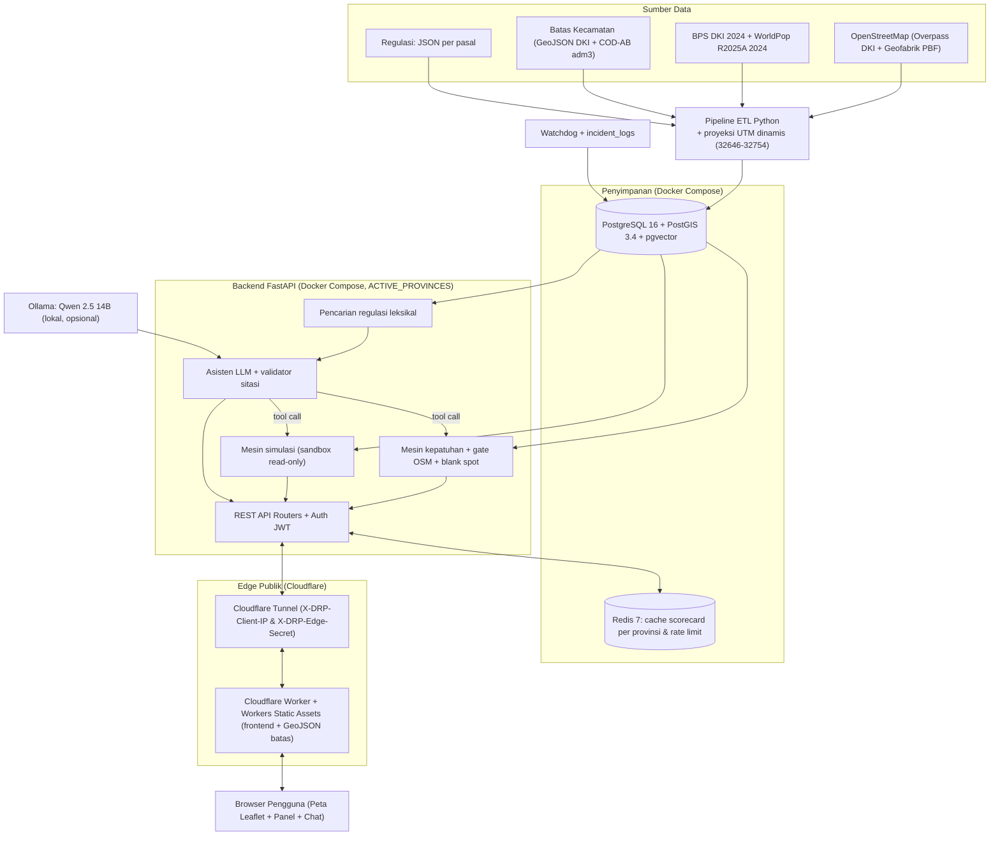
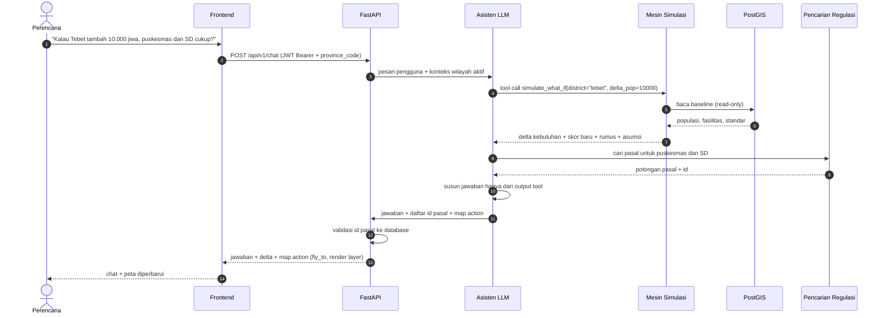

# District Resource Profiling
### Indonesia - 38 Provinsi, 7.033 Kecamatan (DKI Jakarta sebagai wilayah acuan)

> Alat bantu perencana kota untuk (1) mengecek kecukupan fasilitas publik di **38 provinsi (7.033 kecamatan)** di Indonesia—dengan **DKI Jakarta** (44 kecamatan) sebagai wilayah acuan—terhadap SNI 03-1733-2004 dan regulasi terkait, serta (2) menghitung dampak pertambahan penduduk **sebelum** sebuah proyek dibangun. Semua angka dihitung oleh mesin spasial yang dapat diaudit. LLM lokal hanya menerjemahkan pertanyaan, memanggil fungsi, dan mengutip pasal.

**Demo publik:** https://drp.digilabui.cloud (cadangan: https://drp.digilabui.workers.dev). Tamu (*guest*) dapat melihat peta dan skor kecamatan; fitur asisten chat dan simulasi memerlukan akun (login).

*Proyek Mata Kuliah Rekayasa Perangkat Lunak (ENCE605024), Semester 5, Fakultas Teknik Universitas Indonesia. Kelompok 1.*

---

## Daftar Isi
1. [Masalah](#1-masalah)
2. [Solusi dan Prinsip Desain](#2-solusi-dan-prinsip-desain)
3. [Pengguna dan Use Case](#3-pengguna-dan-use-case)
4. [Ruang Lingkup](#4-ruang-lingkup)
5. [Fitur: MVP dan Lanjutan](#5-fitur-mvp-dan-lanjutan) (lihat juga §5.1 Status Implementasi)
6. [Jenis Fasilitas yang Dinilai dan Standarnya](#6-jenis-fasilitas-yang-dinilai-dan-standarnya)
7. [Sumber Data](#7-sumber-data)
8. [Model Perhitungan](#8-model-perhitungan)
9. [Arsitektur](#9-arsitektur)
10. [Alur Chat dan Simulasi](#10-alur-chat-dan-simulasi)
11. [Guardrail dan Evaluasi AI](#11-guardrail-dan-evaluasi-ai)
12. [Monitoring](#12-monitoring)
13. [Ringkasan API](#13-ringkasan-api)
14. [Keterbatasan](#14-keterbatasan)
15. [Kebutuhan Sistem](#15-kebutuhan-sistem)
16. [Menjalankan Proyek](#16-menjalankan-proyek)
17. [Pengujian](#17-pengujian-dan-cakupan-kode)
18. [Struktur Repositori](#18-struktur-repositori)
19. [Roadmap](#19-roadmap)
20. [Tim, Lisensi, dan Atribusi](#20-tim-lisensi-dan-atribusi)

---

## 1. Masalah

| Masalah | Yang terjadi hari ini | Akibat |
|---|---|---|
| **Data terpisah** | Penduduk (BPS), lokasi fasilitas (OpenStreetMap), dan aturan (JDIH/BSN) disimpan di tempat dan format berbeda. | Audit satu kecamatan butuh penggabungan manual. |
| **Tidak ada simulasi pra-konstruksi** | Saat ada rencana apartemen 4.500 unit di sebuah kecamatan, tidak ada cara cepat untuk melihat dampaknya ke puskesmas, SD, dan taman. | Kekurangan fasilitas baru ketahuan setelah penghuni pindah. |
| **LLM tidak bisa dipercaya untuk angka** | Chatbot biasa menebak rasio, jarak, dan nomor pasal. | Angka salah dan kutipan hukum karangan. |

---

## 2. Solusi dan Prinsip Desain

```
Pertanyaan ─► LLM lokal          : pahami pertanyaan, pilih fungsi, jelaskan hasil
                 │ tool call (JSON)
                 ▼
             Mesin deterministik : PostGIS + Python, semua angka dihitung di sini
                 │ angka + id pasal
                 ▼
             Validator sitasi    : pastikan setiap pasal yang dikutip ada di database
                 │
                 ▼
             Peta + jawaban chat
```

**Prinsip:**
1. **LLM tidak pernah menghitung.** Setiap angka di jawaban berasal dari output fungsi.
2. **Setiap angka bisa ditelusuri.** Input yang sama selalu menghasilkan angka yang sama, dan respons menyertakan rumus, asumsi, dan sumber datanya.
3. **Setiap kutipan hukum harus ada di database regulasi.** Kutipan yang tidak ditemukan dibuang dari jawaban.
4. **Simulasi tidak pernah mengubah data master.**
5. **On-premise.** Data dan inferensi tidak dikirim ke layanan cloud.
6. **Sistem tetap berguna tanpa LLM.** Peta, scorecard, dan simulasi jalan tanpa GPU.

---

## 3. Pengguna dan Use Case

| Persona | Kebutuhan | Kriteria penerimaan |
|---|---|---|
| **Utama: perencana / auditor tata ruang** (Bappeda, Dinas Cipta Karya) | Melihat kepatuhan fasilitas per kecamatan untuk memprioritaskan anggaran | Scorecard per pilar + defisit per jenis fasilitas yang dinilai (§6.2) tampil < 2 detik |
| **Utama: perencana** | Melihat area yang tidak terjangkau fasilitas | Peta menampilkan poligon blank spot, % cakupan, dan km² tidak terlayani |
| **Utama: auditor** | Memverifikasi dasar hukum setiap angka | Setiap kutipan menyebut dokumen, bab/pasal, dan ada di database |
| **Sekunder: pengembang properti** | Mengetahui kewajiban fasilitas dari proyek superblok | Hasil simulasi berisi tambahan penduduk, kebutuhan fasilitas tambahan, dan pasal rujukan, dengan label "hipotetis" |

---

## 4. Ruang Lingkup

| Dalam scope | Di luar scope |
|---|---|
| 38 provinsi, 7.033 kecamatan di Indonesia (44 kecamatan DKI Jakarta sebagai wilayah acuan) | Penilaian tingkat kelurahan/desa |
| 7 jenis fasilitas dinilai dalam 2 pilar (§6.2), ditambah 9 jenis informasi (§6.3) | Kualitas layanan (tenaga medis, jam buka, akreditasi) |
| Kepatuhan rasio penduduk dan radius layanan terhadap SNI 03-1733-2004 (dengan *gate* cakupan OSM `"Data tidak memadai"`) | **Keputusan izin, nasihat hukum, atau nilai SNI 1733:2026** (PDF resmi belum tersedia) |
| Simulasi tambahan penduduk, superblok, dan fasilitas baru (*sandbox* baca-saja, perlu login JWT) | Simulasi lalu lintas, banjir, atau ekonomi |
| Asisten chat dengan *tool calling* dan pencarian regulasi (perlu login JWT) | Perubahan data master oleh AI |
| Backend Docker Compose di satu mesin *origin* + Cloudflare Worker (*static assets*) dan Tunnel | Klaster multi-node atau *fallback* cloud LLM |

---

## 5. Fitur: MVP dan Lanjutan

| Fitur | MVP | Lanjutan |
|---|---|---|
| Peta *choropleth* 38 provinsi (7.033 kecamatan) + pemilih provinsi | ✅ | |
| *Scorecard* per pilar + defisit per jenis fasilitas yang dinilai | ✅ | |
| *Blank spot* per jenis fasilitas | ✅ | ✅ Memperhitungkan fasilitas lintas batas wilayah aktif |
| Simulasi tambahan penduduk (perlu akun) | ✅ | |
| Simulasi superblok / kewajiban fasilitas (perlu akun) | ✅ | |
| Simulasi penempatan fasilitas baru (perlu akun) | ✅ (*in-memory sandbox* via `simulate-reduction` & `staged_amenities`) | |
| Pencarian regulasi per pasal | ✅ (leksikal: trigram + *bag-of-words* + sinonim) | *Embedding* semantik (`bge-m3`) |
| Chat dengan *tool calling* (perlu akun) | ✅ (multi-ronde, maks 4 ronde, histori 6 *turn*) | |
| Peta bergerak mengikuti jawaban chat (*fly-to*, *highlight*) | ✅ | |
| *Health check* + *incident log* | ✅ | Notifikasi webhook |
| Aksesibilitas berbasis jaringan jalan | | ✅ |

---

## 5.1 Status Implementasi (rilis nasional, 18 November 2026)

Tabel ini mencatat status kode yang sebenarnya pada rilis nasional 38 provinsi (`bfbc514`).

| Komponen | Status | Catatan |
|---|---|---|
| Peta *choropleth* 38 provinsi (7.033 kecamatan) + *scorecard* 7 standar (§6.2) | **[Implemented]** | DKI Jakarta (`31`, 44/44) menjadi wilayah acuan. Nasional: 1.878 kecamatan di 15 provinsi memiliki skor komposit numerik dan 5.155 kecamatan berstatus `"Data tidak memadai"`. Kolom "Dicek oleh" di §6.2 tetap menandai kebutuhan verifikasi salinan resmi BSN |
| Data penduduk per kecamatan | **[Implemented]** | DKI Jakarta (`31`) memakai data BPS 2024; 37 provinsi lain memakai estimasi model WorldPop R2025A 2024 (*zonal sum* 100 m) yang dicek silang terhadap HDX COD-PS 2020 |
| Klasifikasi fasilitas OSM + *gate* cakupan | **[Implemented]** | 117.575 fasilitas aktif nasional (Overpass untuk DKI, Geofabrik `.osm.pbf` untuk 37 provinsi lain). Ambang `N` per provinsi dan *gate* lokal `sekolah_dasar` mencegah data kosong terbaca 0%. Sampel validasi presisi ada di [pipeline/data/validation/classification_sample.csv](pipeline/data/validation/classification_sample.csv) |
| *Blank spot* lintas batas wilayah aktif | **[Implemented]** | Radius garis lurus dengan proyeksi `utm_srid` dinamis per baris (`32646`–`32754` se-Indonesia) dan pra-filter lintas batas WGS 84. Pos damkar tanpa *blank spot* (SNI tidak memberi radius) |
| Simulasi tambahan penduduk (`what-if`), superblok, & fasilitas hipotetis (`simulate-reduction`) | **[Implemented]** | *Sandbox* baca-saja (*read-only*) terautentikasi JWT. Ambang Rendah/Sedang/Tinggi serta parameter superblok (RTH 20%, retensi 150 mm/hari, KDB 50%) merupakan parameter konfigurasi asumsi tim |
| Pencarian regulasi | **[Implemented] leksikal** | 11 pasal SNI 03-1733-2004 terverifikasi (trigram + *hashed bag-of-words* + sinonim via pgvector). Perda/Permenkes/Permendagri dan *embedding* semantik `bge-m3` belum diaktifkan |
| Asisten chat (multi-ronde, *guardrail* angka, validator sitasi, penolakan izin, *lookup* nama wilayah aktif) | **[Implemented]** | Memerlukan login JWT; evaluasi otomatis 3×30 pertanyaan ([eval/ai_eval_set.json](eval/ai_eval_set.json)) tercatat di [eval/REPORT.md](eval/REPORT.md) |
| Autentikasi pengguna, *rate limit*, & *edge IP* | **[Implemented]** | Registrasi/login JWT HS256 + bcrypt, *lockout brute-force*, batas laju chat per pengguna, serta pembacaan `X-DRP-Client-IP` di balik Cloudflare Worker |
| *Health check*, *watchdog*, *incident log* | **[Implemented]** | Endpoint `/health`, telemetri *read-only*, dan pencatatan ke `incident_logs` |
| Deployment publik & Docker Compose | **[Implemented]** | Cloudflare Worker (*Workers Static Assets* untuk `frontend/`), Cloudflare Tunnel, dan backend Docker Compose dengan `ACTIVE_PROVINCES`; pemuatan per provinsi memakai [pipeline/load_region.py](pipeline/load_region.py) (lihat [docs/REGIONS.md](docs/REGIONS.md)) |
| CI GitHub Actions | **[Implemented]** | Workflow [.github/workflows/tests.yml](.github/workflows/tests.yml) menjalankan `unit`, `integration`, dan `system-api` pada setiap *push* / *pull request* |
| Aksesibilitas jaringan jalan, notifikasi webhook, transisi SNI 1733:2026 | **[Planned]** | Switch ke SNI 1733:2026 menunggu dokumen PDF resmi BSN tersedia |

---

## 6. Jenis Fasilitas yang Dinilai dan Standarnya

### 6.1 Aturan masuk

Sebuah jenis fasilitas **dinilai** (punya kebutuhan, defisit, skor, dan blank spot) hanya jika memenuhi **semua** syarat:

1. **Standar terdokumentasi.** Angka "1 unit per N jiwa" (dan radius, bila dipakai untuk blank spot) diambil kata per kata dari dokumen yang salinannya disimpan di `pipeline/data/sources/`, lengkap dengan nomor tabel dan halaman.
2. **Dicek manusia.** Satu anggota tim membandingkan angka di tabel ini dengan PDF aslinya dan mengisi kolom "Dicek oleh".
3. **Klasifikasi memakai tag OSM + pola nama yang didokumentasikan di `OSM_TAG_MAPPING.md`. Presisinya diukur dari sampel berlabel manusia (`pipeline/data/validation/`); sebelum sampel diisi, presisi = TODO-VERIFY.**
4. **Lolos cek ketersediaan otomatis**: minimal `N` record terklasifikasi di provinsi tersebut (`N` = jumlah kecamatan per provinsi, misalnya 44 untuk DKI Jakarta; lihat §8).

Jenis yang gagal salah satu syarat **tidak pernah ditampilkan sebagai "defisit"**. Paling jauh ditampilkan sebagai jumlah titik OSM dengan label "tidak dinilai".

### 6.2 Dinilai (7 jenis, 2 pilar)

| Pilar | Jenis | 1 unit per | Radius | Sumber | Dicek oleh |
|---|---|---|---|---|---|
| Pendidikan | Taman Kanak-kanak | 1.250 jiwa | 500 m | SNI 03-1733-2004, Tabel 8, hal. 26 | `[NAMA]` |
| Pendidikan | Sekolah Dasar | 1.600 jiwa | 1.000 m | SNI 03-1733-2004, Tabel 8, hal. 26 | `[NAMA]` |
| Pendidikan | SMP (SNI: SLTP) | 4.800 jiwa | 1.000 m | SNI 03-1733-2004, Tabel 8, hal. 26 | `[NAMA]` |
| Pendidikan | SMA/SMK (SNI: SMU) | 4.800 jiwa | 3.000 m | SNI 03-1733-2004, Tabel 8, hal. 26 | `[NAMA]` |
| Kesehatan & Keselamatan | Puskesmas pembantu (kelurahan) | 30.000 jiwa | 1.500 m | SNI 03-1733-2004, Tabel 12, hal. 29 | `[NAMA]` |
| Kesehatan & Keselamatan | Puskesmas (kecamatan) | 120.000 jiwa | 3.000 m | SNI 03-1733-2004, Tabel 12, hal. 29 | `[NAMA]` |
| Kesehatan & Keselamatan | Pos pemadam kebakaran (tingkat kecamatan) | 120.000 jiwa | tidak ada di SNI, jadi tanpa blank spot | SNI 03-1733-2004, Tabel 6, hal. 23-24 | `[NAMA]` |

Catatan:
- **SMK disamakan dengan SMU.** Ini keputusan tim; SNI 2004 hanya menyebut SMU.
- **Pemetaan puskesmas di Jakarta.** Jakarta menyebut fasilitas tingkat kelurahan "Puskesmas Kelurahan", bukan "Puskesmas Pembantu". Penyamaan keduanya adalah keputusan tim (`TODO-DECIDE`).

### 6.3 Ditampilkan sebagai informasi saja (tidak dinilai)

| Jenis | Alasan tidak dinilai |
|---|---|
| Rumah sakit | Tidak ada di SNI 03-1733-2004, dan melayani lintas kecamatan |
| Posyandu | Ada di SNI (Tabel 12: 1.250 jiwa, 500 m), tetapi data OSM tidak representatif (contoh: Kelapa Gading hanya 1 titik) |
| Stasiun transit, halte TransJakarta | Tidak ada standar "1 unit per N jiwa". Hanya jumlah titik yang ditampilkan |
| Pasar | Ada di SNI bagian 7.5, tetapi barisnya belum diekstrak dari PDF (`TODO-VERIFY`) |
| Taman RT/RW/kelurahan/kecamatan | Ada di SNI bagian 7.7, tetapi OSM tidak membedakan tingkat taman |
| RPTRA | Tidak ada standar jumlah per penduduk yang terverifikasi |

### 6.4 Dihapus dari sistem

| Jenis | Alasan |
|---|---|
| TPS 3R | Tidak ada di SNI 03-1733-2004 (rujukan "Bab 5.7 Tabel 15" tidak ada). Klasifikasi OSM menebak dari kata "tps" |
| Hidran kebakaran | SNI 03-1733-2004 hanya merujuk standar hidran lain, tidak memberi angka |
| Hutan kota, gelanggang olahraga | Tidak ada di SNI 03-1733-2004 |
| Perpustakaan wilayah | Hanya 5 record OSM se-DKI. SNI hanya menyebut taman bacaan (2.500 jiwa) |
| Sentra niaga UMKM | Tidak ada standar dan 0 record OSM |
| Pos polisi | SNI hanya menyebut pos kamtib dan kantor polisi. Tag OSM `amenity=police` mencampur keduanya |

### 6.5 Bobot dan nama indeks

- **Bobot pilar adalah keputusan tim, bukan dari regulasi** (`TODO-DECIDE`): Kesehatan & Keselamatan 0,30 dan Pendidikan 0,25 (bobot awal), lalu diskalakan ulang ke pilar yang aktif (§8).
- **Nama indeks:** "Indeks Kecukupan Fasilitas Dasar". Bukan "Indeks Kelayakan Hidup", karena ruang hidup, mobilitas, dan kualitas lingkungan tidak diukur.

### 6.6 Sumber dokumen

| Dokumen | Salinan | Keterangan |
|---|---|---|
| SNI 03-1733-2004 *Tata cara perencanaan lingkungan perumahan di perkotaan* (BSN) | `pipeline/data/sources/README.md` (URL + SHA-256; PDF tidak disimpan di repo karena hak cipta BSN) | Salinan dari mirror tidak resmi. Tim wajib mencocokkan dengan salinan resmi BSN sebelum UAS |

Nomor bab di SNI ini adalah **Bab 7** (7.1 pemerintahan, 7.2 pendidikan, 7.3 kesehatan, 7.5 perdagangan, 7.7 ruang terbuka). Rujukan "Bab 5.x" di kode dan korpus lama **salah** dan harus diganti.

---


## 7. Sumber Data

| Data | DKI Jakarta (`31`, acuan) | 37 Provinsi Lain (`11`–`96`) | Lisensi & Catatan |
|---|---|---|---|
| **Batas kecamatan** | GeoJSON 44 kecamatan ([jakarta_44_kecamatan.geojson](pipeline/data/boundaries/jakarta_44_kecamatan.geojson), BPS / Kemendagri) | **HDX COD-AB Indonesia** (`cod-ab-idn`, layer `idn_admin3`, BPS / BIG via OCHA ROAP), mengecualikan poligon air/hutan (`555`/`888`/`999`); Papua dipetakan ke 6 provinsi pasca-UU 2022 + Kepmendagri 100.1.1-6117/2022 | DKI: Public Domain / ODbL<br>Non-DKI: **CC BY-IGO**<br>Disimpan di SRID 4326 dan `utm_srid` dinamis per baris (`32646`–`32754`) |
| **Penduduk per kecamatan** | **BPS Provinsi DKI Jakarta 2024** (*Statistik Daerah 2024*, [jakarta_demographics_bps.json](pipeline/data/boundaries/jakarta_demographics_bps.json)) | **WorldPop Global2 *constrained* 100 m** (`G2_CN_POP_R25A_100m`, rilis R2025A, 2024) via *zonal sum* per poligon COD-AB, dicek silang terhadap **HDX COD-PS 2020** (BPS) | DKI: Data Terbuka Pemerintah (BPS)<br>Non-DKI: **CC BY 4.0**<br>Ditandai `"Estimasi model WorldPop R2025A 2024"`; 5 kecamatan tanpa piksel pemukiman ditandai `"Data tidak memadai"` |
| **Lokasi fasilitas** | OpenStreetMap via Overpass API (snapshot `2026-10-14`, 14.496 fasilitas aktif) | OpenStreetMap via ekstrak `.osm.pbf` pulau **Geofabrik** (`java`, `sumatra`, `nusa-tenggara`, `kalimantan`, `sulawesi`, `maluku`, `papua`) dengan aturan tag yang sama ([OSM_TAG_MAPPING.md](pipeline/data/facilities/OSM_TAG_MAPPING.md)); total nasional 117.575 fasilitas aktif | **ODbL 1.0**<br>Simpan `source_id` asli dan tanggal *snapshot* |
| **Teks regulasi** | SNI 03-1733-2004 (16 standar + 11 potongan pasal terverifikasi di JSON) | Sama (standar nasional) | JDIH / BSN |

Rincian URL, tanggal unduh, hash SHA-256, dan perbandingan WorldPop vs COD-PS 2020 tercatat di [docs/REGIONS.md](docs/REGIONS.md) serta [pipeline/data/sources/REGION_SOURCES.md](pipeline/data/sources/REGION_SOURCES.md).

---

## 8. Model Perhitungan

**Kebutuhan dan defisit**
```
N_required = max(1, ceil(Populasi / Threshold))
Defisit    = N_existing - N_required
```

**Ketersediaan Data Fasilitas — Ambang Tingkat Provinsi (Standards Availability)**
Setiap jenis fasilitas dinilai di §6.2 dievaluasi ketersediaannya pada tingkat provinsi dengan ambang `N` = **jumlah kecamatan di provinsi tersebut** (misalnya `44` untuk DKI Jakarta, `627` untuk Jawa Barat, `573` untuk Jawa Tengah, `78` untuk DI Yogyakarta, `666` untuk Jawa Timur, `155` untuk Banten). Jenis yang tidak `available` tidak diberi kebutuhan, defisit, maupun skor:
- `available`: memiliki $\ge N$ rekaman terklasifikasi di provinsi tersebut.
- `insufficient`: memiliki data namun $< N$ rekaman (dikecualikan dari skor pilar, bukan dihitung 0).
- `not_available`: memiliki 0 rekaman atau tidak memiliki pemetaan tag OSM yang valid.

**Gate Cakupan OSM Lokal per Kecamatan (`osm_coverage`)**
Untuk mencegah wilayah dengan pemetaan OSM minim terlihat seperti kepatuhan 0%, kecamatan dengan `penduduk >= 1.600` (membutuhkan $\ge 1$ SD menurut SNI 03-1733-2004) dan `0` `sekolah_dasar` terpetakan di OSM (serta 5 kecamatan dengan `penduduk = 0`) ditandai `osm_coverage.status = "tidak_memadai"` (`data_availability = "insufficient_local"`):
- Skor pilar dan skor komposit disimpan sebagai `NULL` (tidak pernah `0`), ditampilkan sebagai `"Data tidak memadai"`, serta dikecualikan dari peringkat dan rata-rata provinsi.
- Metadata `osm_coverage` (`status`, `mapped_sd`, `required_sd`, `rule`) disimpan pada `district_compliance_scores.coverage` dan dikembalikan oleh API.
- **DKI Jakarta (`31`) tidak berubah:** seluruh 44 kecamatan DKI berstatus `memadai` dengan skor identik. Secara nasional (38 provinsi, 7.033 kecamatan), **1.878 kecamatan** di 15 provinsi memiliki skor komposit numerik dan **5.155 kecamatan** menampilkan `"Data tidak memadai"`.

**Skor per jenis fasilitas** (dibatasi 100 agar surplus satu jenis tidak menutupi kekurangan jenis lain)
```
S_jenis = min(100, N_existing / N_required × 100)
S_pilar = rata-rata S_jenis yang berstatus 'available' dalam pilar
```

**Aturan Skor Komposit & Re-weighting Proporsional**
- Sebuah pilar **hanya dihitung dalam skor komposit jika memiliki $\ge 2$ jenis fasilitas** yang berstatus `available`.
- Pilar yang punya kurang dari 2 jenis `available` ditampilkan dengan status `cakupan data rendah`, **tanpa angka skor**, dan bobotnya 0 dalam komposit (`included_in_composite: false`).
- Bobot pilar aktif diskalakan ulang secara proporsional: `W'_i = W_i / jumlah W_k pilar aktif`.
- Contoh DKI Jakarta (kedua pilar aktif): Kesehatan & Keselamatan 0,30 / 0,55 = 54,5%, Pendidikan 0,25 / 0,55 = 45,5%. Jika hanya `education` yang memenuhi syarat (misalnya di 14 provinsi lain yang berskor komposit), bobot `education` menjadi 100%; jika kedua pilar tidak memenuhi syarat (23 provinsi), skor komposit bernilai `NULL` (`"Data tidak memadai"`).

**Tingkat Indikasi Dampak Simulasi (`TODO-DECIDE (team)`)**
Indikasi beban fasilitas pada simulasi What-If dan Superblok dievaluasi berbasis perubahan skor dan unit defisit baru:
- `Rendah`: $\Delta \text{skor} > -1.0$ DAN 0 unit defisit baru pada fasilitas `available`.
- `Tinggi`: $\Delta \text{skor} \le -5.0$ ATAU $\ge 3$ unit defisit baru pada fasilitas `available`.
- `Sedang`: Selain kondisi di atas.
*Catatan:* Nilai ambang batas (`-1.0`, `0`, `-5.0`, `3`) adalah parameter konfigurasi (`TODO-DECIDE (team)`) yang diekspos di respons API.

**Blank spot** (proyeksi metrik UTM dinamis per kecamatan via `compute_utm_srid()`, mencakup `EPSG:32646`–`32754` se-Indonesia; `EPSG:32748` untuk DKI Jakarta)
```
blank_spot = ST_Difference(batas_kecamatan, ST_Union(ST_Buffer(fasilitas, radius)))
cakupan %  = (luas_kecamatan − luas_blank_spot) / luas_kecamatan × 100
```
Fasilitas di kecamatan sekitar pada wilayah aktif yang radius layanannya menjangkau batas kecamatan target turut diperhitungkan (pra-filter WGS 84 dan reproyeksi ke `utm_srid` kecamatan target).

**Contoh:** kecamatan 120.000 jiwa dengan 3 puskesmas kelurahan memberi `N_required = 4`, `Defisit = −1`, dan `Skor = 75`.

---

## 9. Arsitektur



**Keputusan teknologi dan alasannya**

| Keputusan | Alasan |
|---|---|
| **Cloudflare Worker + Tunnel** | Aset statis (*HTML*, modul JS, dan GeoJSON per provinsi) disajikan dari *Workers Static Assets*, sedangkan permintaan `/api/*`, `/health`, dan `/data/*` diteruskan via Cloudflare Tunnel ke *origin* Docker Compose lokal dengan header `X-DRP-Client-IP` dan `X-DRP-Edge-Secret` agar *rate limiting* tetap akurat per pengunjung. |
| **`ACTIVE_PROVINCES`** | Variabel lingkungan di backend yang menentukan provinsi mana saja yang aktif dilayani API (`Active` vs `Staging` / `Planned`) sehingga pemuatan data nasional di *staging* terpisah dari rilis publik. |
| **Ollama** untuk serving LLM | Setup satu perintah, mendukung *tool calling*, berjalan lokal di server lab tanpa mengirim data ke penyedia cloud LLM. |
| **Leaflet** untuk peta | Batas kecamatan dimuat per provinsi dari `frontend/data/boundaries/` (setiap file GeoJSON disederhanakan < 3 MB), sehingga tetap ringan di Leaflet tanpa perlu WebGL (MapLibre/Deck.gl). |
| **Regulasi dikurasi manual** | Korpusnya kecil (11 pasal terverifikasi), dan kutipan hukum harus tepat. OCR otomatis menambah risiko salah pasal. |
| **Tanpa fallback cloud LLM** | Konsisten dengan prinsip pemrosesan lokal (*on-premise*). Jika LLM mati, sistem memakai ringkasan deterministik. |
| **Redis untuk cache scorecard & rate limit** | Menyimpan cache *scorecard* terlingkup per provinsi (`cache:compliance:scores:<province_code>`) serta penghitung *rate limit* login dan chat. Respons LLM tidak di-cache otomatis agar tidak salah konteks. |
| **Pencarian regulasi leksikal via pgvector** | Menggunakan trigram, *hashed bag-of-words*, dan sinonim yang dipetakan ke kolom pgvector; model *dense embedding* (`bge-m3`) ditunda agar dependensi eksternal nol dan tidak butuh GPU saat ingesti korpus. |

---

## 10. Alur Chat dan Simulasi



**Contoh simulasi:** superblok 4.500 unit × 3 jiwa/unit = 13.500 jiwa baru.

```
ΔPuskesmas kelurahan = ceil(P_baru / 30.000) − ceil(P_lama / 30.000)
ΔSD                  = ceil(P_baru / 1.600)  − ceil(P_lama / 1.600)
```

Satu rumus delta dipakai untuk semua jenis fasilitas. Asumsi (jiwa per unit) ditampilkan di respons.

**Label output:** *"Indikasi dampak: Rendah / Sedang / Tinggi. Bukan keputusan perizinan; untuk bahan diskusi perencanaan."* Dasar ambang batas Rendah/Sedang/Tinggi didokumentasikan di konfigurasi.

---

## 11. Guardrail dan Evaluasi AI

**Guardrail**

| Risiko | Pengendalian |
|---|---|
| LLM mengarang angka | Prompt sistem melarang angka di luar output tool. Angka di jawaban dicocokkan dengan output tool. |
| LLM mengarang pasal | Validator sitasi membuang id pasal yang tidak ada di database. |
| Pertanyaan di luar scope (izin, nasihat hukum) | Asisten menolak dengan sopan dan menjelaskan batas scope. |
| LLM tidak tersedia | Fallback ke ringkasan deterministik dari output tool. |

**Evaluasi (Hasil Pengujian Riil 3-Run pada Qwen 2.5 14B)**

Hasil evaluasi otomatis menggunakan set uji 30 pertanyaan ([eval/ai_eval_set.json](eval/ai_eval_set.json)) yang dijalankan sebanyak 3 kali (total 90 inferensi) terhadap Ollama lokal ([eval/REPORT.md](eval/REPORT.md)):

| Metrik | Cara ukur | Target (§11) | Hasil Rerata (3 Run) | Status |
|---|---|---|---|---|
| **Ketepatan pemilihan tool** | Set uji 30 pertanyaan dengan tool yang diharapkan | $\ge 90\%$ | **100.0%** (min 100.0% - max 100.0%) | **PASS** |
| **Tingkat Error Sistem (Error Rate)** | Kegagalan eksekusi tak tertangani (exception/crash) | 0% | **0.0%** (min 0.0% - max 0.0%) | **PASS** |
| **Kebocoran angka jawaban final** | Angka tidak terverifikasi yang lolos ke jawaban final | 0 | **0.0** | **PASS** |
| **Sitasi jawaban final konsisten dengan korpus terverifikasi** | Sitasi tidak konsisten / tidak terverifikasi yang lolos ke jawaban final | 0 | **0.0** | **PASS** |
| **Akurasi penolakan scope** | Pertanyaan izin/nasihat hukum ditolak | $100\%$ | **100.0%** | **PASS** |
| **Capaian nilai yang diharapkan** | Kelengkapan nilai acuan spesifik pada respons | Dilaporkan apa adanya | **88.9%** (min 86.7% - max 90.0%) | Dilaporkan |
| **Angka raw tanpa sumber tertangkap** | Jumlah angka tidak berdasar pada raw LLM yang diblokir guardrail | Dilaporkan apa adanya | **0.3** | Dilaporkan |
| **Tingkat halusinasi sitasi raw** | Frekuensi raw LLM mencantumkan sitasi tak berdasar | Dilaporkan apa adanya | **34.4%** | Dilaporkan |
| **Tingkat Guardrail Fallback** | Frekuensi aktivasi ringkasan deterministik | Dilaporkan apa adanya | **1.1%** (min 0.0% - max 3.3%) | Dilaporkan |
| **Tingkat Guardrail Retry** | Frekuensi retry koreksi angka/label mandiri | Dilaporkan apa adanya | **1.1%** | Dilaporkan |
| **Latensi respons (p50 / p95)** | Waktu eksekusi inferensi AI end-to-end | Dilaporkan apa adanya | **3.21s / 16.06s** | Dilaporkan |

*Catatan Target Evaluasi:*
- **Kebocoran Angka (0.0 PASS):** Numeric guardrail secara konsisten memblokir seluruh angka tidak berdasar pada raw LLM dan mengalihkannya ke fallback deterministik sehingga tidak ada angka liar yang tembus ke pengguna.
- **Sitasi Konsisten dengan Korpus Terverifikasi (0.0 PASS):** Validator sitasi secara ketat memvalidasi seluruh referensi pasal terhadap korpus dokumen terverifikasi (PDF-matched) dan membuang tag tidak valid atau tidak terverifikasi, mencapai target 0.0 kebocoran di jawaban final.
- **Pembaruan rilis nasional (18 November 2026):** evaluasi ulang 3×30 setelah penambahan *lookup* nama kecamatan di provinsi aktif (`e0196a2`) mencatat ketepatan pemilihan tool **100%**, penolakan scope **100%**, **0** kebocoran angka maupun sitasi, serta latensi **p50 5,11s / p95 21,55s** (lihat [docs/TESTING.md](docs/TESTING.md)).

---

## 12. Monitoring

Cukup sederhana untuk skala satu mesin:
- **Health check** `/health`: status PostgreSQL, Redis, dan Ollama.
- **Incident log**: setiap kegagalan dicatat ke tabel `incident_logs`.
- **Notifikasi** (lanjutan): webhook Discord/Telegram satu arah.

Restart otomatis **tidak** dilakukan dari dalam aplikasi. Restart container adalah tanggung jawab Docker (`restart: unless-stopped`).

---

### 12.1 Log Chat AI

Setiap giliran chat dari pengguna yang login dicatat di dua tempat:

- **Database**: tabel `chat_logs` (pertanyaan, jawaban, *tools* yang dipakai, status *guardrail*, latensi, model, provinsi). Baris lebih tua dari `CHAT_LOG_RETENTION_DAYS` (bawaan 90 hari) dihapus otomatis. Tabel `chat_audit` tetap hanya menyimpan telemetri tanpa teks.
- **Berkas lokal**: satu baris JSON per giliran di `/app/logs/chat_log.jsonl` dalam container, di-*mount* ke folder host `CHAT_LOG_HOST_DIR`, dengan rotasi ukuran (`CHAT_LOG_FILE_MAX_MB`, `CHAT_LOG_FILE_BACKUPS`). Berkas tetap ditulis walau insert database gagal. Folder `logs/` dan `chat-logs/` jangan di-*commit*.

Pengguna melihat pemberitahuan di bawah kotak chat dan bisa membuka atau menghapus riwayatnya sendiri lewat tombol **Riwayat** (`GET` / `DELETE /api/v1/chat/history`, hanya baris milik sendiri). Penghapusan oleh pengguna tidak menghapus salinan di berkas lokal server.

## 13. Ringkasan API

Tamu (*guest*) dapat memanggil seluruh endpoint `GET` publik (kecuali `/api/v1/auth/me`). Endpoint `POST` simulasi, pencarian regulasi, dan chat asisten memerlukan header `Authorization: Bearer <token>` (JWT HS256 dari `/api/v1/auth/login`). Parameter opsional `province_code` memakai kode Kemendagri (default `31` DKI Jakarta).

| Method | Endpoint | Akses | Fungsi |
|---|---|---|---|
| GET | `/health` | Publik | Status layanan (PostgreSQL, Redis, Ollama, model aktif) |
| GET | `/api/v1/regions` | Publik | Daftar 38 provinsi beserta status *runtime* (`Active`/`Staging`/`Planned`), `bbox`, `utm_srid`, sumber data, dan ringkasan cakupan |
| GET | `/api/v1/regions/{province_code}` | Publik | Detail konfigurasi dan status satu provinsi aktif (`404` jika belum `Active`) |
| POST | `/api/v1/auth/register` | Publik | Registrasi akun baru (dapat dinonaktifkan via `AUTH_ALLOW_REGISTER=false`) |
| POST | `/api/v1/auth/login` | Publik | Autentikasi email & kata sandi untuk memperoleh JWT *access token* (dilindungi *brute-force lockout*) |
| GET | `/api/v1/auth/me` | JWT | Profil pengguna aktif dan batas *rate limit* chat |
| POST | `/api/v1/auth/logout` | Publik | Konfirmasi keluar dari sesi JWT *stateless* |
| GET | `/api/v1/districts?province_code=` | Publik | *Scorecard* semua kecamatan di provinsi aktif (default `31`), lengkap dengan `osm_coverage` dan `score_status` |
| GET | `/api/v1/districts/{code}?province_code=` | Publik | Detail *scorecard* satu kecamatan, `boundary_geojson`, dan rincian defisit (`province_code` opsional untuk disambiguasi nama) |
| GET | `/api/v1/meta/standards` | Publik | Katalog 16 standar sesuai §6.2 (dinilai) dan §6.3 (informasi), lengkap dengan sumber tabel/halaman |
| GET | `/api/v1/facilities?province_code=&district_code=&pillar=&facility_type=&search=&limit=` | Publik | Pencarian multi-filter fasilitas publik (§6.2 dan §6.3) pada provinsi aktif |
| GET | `/api/v1/spatial/buffers?district_code=&facility_type=&pillar=&province_code=` | Publik | Poligon buffer radius layanan dalam `utm_srid` kecamatan target (GeoJSON FeatureCollection) |
| GET | `/api/v1/spatial/blank-spots?district_code=&facility_type=&province_code=` | Publik | Poligon *blank spot* per jenis fasilitas dengan jangkauan lintas batas wilayah aktif |
| POST | `/api/v1/spatial/blank-spots/simulate-reduction` | JWT | Simulasi reduksi area *blank spot* dengan fasilitas hipotetis |
| POST | `/api/v1/simulation/what-if` | JWT | Simulasi lonjakan penduduk *sandbox* deterministik |
| POST | `/api/v1/simulation/superblock` | JWT | Simulasi dampak pembangunan kawasan superblok terpadu |
| POST | `/api/v1/rag/search` | JWT | Pencarian pasal regulasi berbasis leksikal (trigram + *hashed bag-of-words* + sinonim) |
| GET | `/api/v1/rag/legal-chunks?query=&pillar=` | Publik | Pengambilan pasal regulasi mentah dari basis data hukum |
| POST | `/api/v1/chat` | JWT | Asisten tata ruang (multi-round *tool calling*, konteks `province_code`, guardrail, *rate limit* per pengguna) |
| GET | `/api/v1/watchdog/telemetry` | Publik | Telemetri kesehatan container & layanan (read-only GET) |
| GET | `/api/v1/watchdog/incidents` | Publik | Riwayat *audit trail* insiden sistem dan *guardrail fallback* |

*Catatan:* Endpoint `POST /api/v1/rag/hybrid-search` dan `POST /api/v1/chat/conversation` dipertahankan sebagai alias terdepresiasi (*deprecated*) untuk kompatibilitas ke belakang.

Dokumentasi interaktif lengkap: `/docs` (Swagger UI).

---

## 14. Keterbatasan

- Aksesibilitas memakai **radius garis lurus**, bukan jarak tempuh jaringan jalan. Indeks ini adalah **proksi** konsep *15-minute city*, bukan pengukuran rute berjalan kaki.
- Skor berbasis **jumlah unit**, belum kapasitas tempat tidur rumah sakit atau daya tampung siswa/ruang kelas.
- Rumah sakit melayani lintas kecamatan sehingga hanya ditampilkan sebagai informasi (tidak dinilai dalam skor).
- **Ketimpangan Cakupan OpenStreetMap (OSM) di Luar DKI Jakarta:** Kelengkapan pemetaan OSM di 37 provinsi luar DKI sangat bervariasi. Sebanyak 5.155 dari 7.033 kecamatan berstatus `"Data tidak memadai"` (`NULL`) karena 0 SD terpetakan pada penduduk $\ge 1.600$ jiwa, kurang dari 2 jenis fasilitas memenuhi ambang provinsi `N`, atau 0 penduduk pada raster. Bahkan kecamatan yang lolos *gate* (`memadai`) **cenderung menghasilkan skor lebih rendah daripada kondisi lapangan sebenarnya** karena *under-counting* di OSM, sehingga skor di luar DKI wajib dibaca bersama metadata `osm_coverage` dan bukan sebagai bukti mutlak kekurangan fisik (kartu skor berlabel *"Defisit menurut data OSM (bukan data resmi Dapodik/Dinkes)"*).
- **Populasi Estimasi Model di Luar DKI Jakarta:** Data penduduk di 37 provinsi luar DKI (`11`–`21`, `32`–`96`) berasal dari estimasi model dasimetrik **WorldPop R2025A 2024** (*Estimasi model WorldPop R2025A 2024*), bukan rilis BPS per kecamatan sebagaimana DKI Jakarta (`31`), dan 5 kecamatan terpencil/pulau kecil (`76.04.023` di Sulawesi Barat serta 4 kecamatan pegunungan di Papua Pegunungan `95`) memiliki 0 piksel pemukiman terdeteksi (`population = 0`).
- **Standar SNI 1733:2026 Belum Diterapkan:** BSN menerbitkan **SNI 1733:2026** pada Mei 2026, namun salinan PDF resminya belum tersedia untuk verifikasi. Oleh karena itu, sistem tetap memakai standar terverifikasi **SNI 03-1733-2004** dan belum mengklaim angka standar 2026.
- **Latensi Chat Pertama Setelah *Idle*:** Ketika model `qwen2.5:14b` (8,99 GB) telah dikeluarkan dari VRAM selama masa *idle*, pemuatan ulang model (*cold load*) menambah jeda ~15–30 detik (atau hingga ~65 detik *end-to-end* pada permintaan chat pertama di deployment publik) sebelum kueri berikutnya merespons dalam ~3–6 detik.
- **Cakupan Lintas Batas:** Buffer lintas batas hanya memperhitungkan fasilitas di provinsi yang aktif dalam `ACTIVE_PROVINCES`.
- **Discrepancy Luas Administratif vs Geometri:** Terdapat perbedaan antara luas administratif rujukan BPS dan luas poligon geometri batas kecamatan (misalnya di Kepulauan Seribu Selatan dan Kepulauan Seribu Utara). Persentase cakupan fasilitas dihitung berbasis luas poligon geometri dan UI memunculkan catatan serta banner peringatan bila rasio poligon/BPS melebihi 1,5x.
- Luas RTH per kapita dan target RTH 30% **tidak diukur**, karena butuh data poligon tutupan vegetasi dan taman kota.
- Kesesuaian zonasi RDTR **tidak diperiksa**, karena butuh peta zonasi detail yang tidak termasuk dalam dataset terbuka.

---

## 15. Kebutuhan Sistem

| Komponen | Minimum | Catatan |
|---|---|---|
| OS | Linux, macOS, atau Windows WSL2 | |
| Python | 3.12 | |
| Docker | Engine 24+ dengan Compose v2 | |
| GPU | **Tidak wajib** | Peta, scorecard, dan simulasi jalan di CPU |
| LLM (opsional) | GPU 12 sampai 16 GB untuk `qwen2.5:14b` (Q4), atau 8 GB untuk `qwen2.5:7b` | |

---

## 16. Menjalankan Proyek

```bash
# 1. Setup lingkungan
cp .env.example .env
# Setel POSTGRES_PASSWORD, AUTH_JWT_SECRET (rahasia JWT acak),
# dan ACTIVE_PROVINCES (default 31; atau daftar kode provinsi yang dimuat) di .env
python3 -m venv .venv && source .venv/bin/activate
pip install -r requirements.txt

# 2. Database dan cache
docker compose -f docker/docker-compose.yml up -d db cache

# 3. Migrasi skema & muat data acuan DKI Jakarta
PYTHONPATH=. python pipeline/boundary_loader.py
PYTHONPATH=. python pipeline/regulation_loader.py
PYTHONPATH=. python pipeline/migrate_auth.py
PYTHONPATH=. python pipeline/migrate_multiregion.py
PYTHONPATH=. python pipeline/verify_db.py

# 4. (Opsional) LLM lokal
ollama pull qwen2.5:14b

# 5. Jalankan aplikasi (atau pakai docker compose up -d)
uvicorn backend.app.main:app --host 0.0.0.0 --port 8000 --reload
```

**Memuat provinsi lain ke database *staging*:**
`pipeline/load_region.py` memiliki pengaman (*live-DB guard*) yang menolak menulis ke database `district_profiling` tanpa `--allow-live`. Siapkan database *staging* terlebih dahulu, jalankan migrasi, lalu uji dengan `--dry-run` sebelum memuat data:

```bash
POSTGRES_DB=district_profiling_stage PYTHONPATH=. python pipeline/migrate_multiregion.py
POSTGRES_DB=district_profiling_stage REDIS_DB=1 PYTHONPATH=. python pipeline/load_region.py --province 34 --dry-run
POSTGRES_DB=district_profiling_stage REDIS_DB=1 PYTHONPATH=. python pipeline/load_region.py --province 34
```

Panduan lengkap persiapan dataset mentah, verifikasi *staging*, promosi ke database *live*, dan deployment Cloudflare Worker tersedia di [docs/REGIONS.md](docs/REGIONS.md) dan [deploy/cloudflare/README.md](deploy/cloudflare/README.md).

Akses lokal: aplikasi di `http://localhost:8000`, Swagger di `/docs`.

**Troubleshooting**

| Masalah | Solusi |
|---|---|
| Port 5432/6379 sudah dipakai | Ubah `POSTGRES_PORT` / `REDIS_PORT` di `.env` |
| `No module named 'backend'` | `export PYTHONPATH="$(pwd):$PYTHONPATH"` dari root repo |
| Token login hangus setelah *restart* | Pastikan `AUTH_JWT_SECRET` diisi tetap di `.env` (jika kosong, backend membuat nilai acak baru setiap startup) |
| Reset database | `docker compose -f docker/docker-compose.yml down -v`, lalu ulangi langkah 2 dan 3 |

---

## 17. Pengujian dan Cakupan Kode

Pengujian diotomatisasi menggunakan `pytest` dalam piramida tiga lapis (panduan lengkap dan *defect log* di [docs/TESTING.md](docs/TESTING.md)):

| Lapis / Marker | Keterangan & Lingkungan | Jumlah Uji (`bfbc514`) | Butuh DB | Butuh GPU/LLM |
|---|---|---|---|---|
| **Unit** (`unit`, `backend/tests/unit/`) | Logika murni, formula SNI, *coverage gate*, *guardrail*, sanitasi sitasi, *auth*, dan katalog 38 provinsi | **133 uji** (133/133 PASS) | **Tidak** (offline) | **Tidak** |
| **Integration** (`db`, `backend/tests/integration/`) | Query PostGIS 38 provinsi, `utm_srid` N/S dinamis, *blank spot* lintas zona, cache Redis, auth DB | **50 uji** (50/50 PASS) | **Ya** (PostGIS + Redis) | **Tidak** |
| **System** (`system`, `backend/tests/system/`) | 9 uji API Uvicorn, 6 uji Playwright UI, 7 uji live chat Ollama (`llm`), dan 4 uji E2E multi-wilayah | **26 uji** (26/26 PASS) | **Ya** (PostGIS + Redis) | **Sebagian** (`llm`: Ollama) |
| **Total** | Seluruh rangkaian uji pada rilis nasional (`bfbc514`) | **209 uji** (100% PASS) | — | — |

**Cakupan Kode & Performa Terukur (`bfbc514`):**
- **Cakupan pernyataan (*statement coverage*):** dijalankan pada uji `unit` + `db and not llm` (**183 lolos**, 26 *deselected* dalam 11,34 dtk) terhadap kode aplikasi inti (`backend/app` dan `watchdog`): **86%** dari **3.210 statements** (435 missed), melampaui target NFR $\ge 70\%$.
  - Modul kritis: `simulation.py` **97%**, `spatial.py` **95%**, `api/routers/simulation.py` **95%**, `api/routers/auth.py` **94%**, `api/routers/regions.py` **92%**, `standards_availability.py` **89%**, `rag/hybrid_search.py` **89%**, `api/routers/districts.py` **88%**, `api/routers/chat.py` **87%**, `core/auth.py` **85%**, `agent/guardrails.py` **84%**, `agent/orchestrator.py` **83%**.
- **Latensi API terukur (30 request berurutan pada server *staging*):** `/api/v1/regions` median **0,52 ms**, scorecard Tebet **1,29 ms**, scorecard Denpasar Selatan **5,99 ms**, *blank spot* Tebet **5,12 ms**, daftar 627 kecamatan Jawa Barat **113,57 ms** (semua p95 < 2.000 ms).

**Menjalankan Uji & CI:**
```bash
# 1. Perintah CI unit test (100% offline, sesuai .github/workflows/tests.yml):
POSTGRES_HOST=invalid.local POSTGRES_PORT=54321 REDIS_HOST=invalid.local REDIS_PORT=63799 OLLAMA_BASE_URL=http://invalid.local:1 AUTH_JWT_SECRET=ci-unit-secret pytest backend/tests/unit -m unit --cov=backend/app --cov=watchdog --cov-report=term-missing -v

# 2. Atau gunakan runner terpadu:
python run_all_tests.py --unit
python run_all_tests.py --integration
python run_all_tests.py --system
```

Workflow CI GitHub Actions ([.github/workflows/tests.yml](.github/workflows/tests.yml)) menjalankan tiga *job* pada setiap *push* / *pull request*: `unit`, `integration`, dan `system-api` (uji browser Playwright UI dan live Ollama chat dijalankan lokal).

---

## 18. Struktur Repositori

```text
.github/
  workflows/          Workflow CI GitHub Actions (tests.yml: unit, integration, system-api)
backend/
  app/
    agent/            Asisten LLM, definisi tool, validator sitasi & guardrail
    api/
      deps.py         Dependensi DB/Redis & verifikasi JWT
      schemas.py      Skema Pydantic v2 request/response
      routers/        Router modular (auth, chat, districts, meta, rag, regions, simulation, spatial, watchdog)
    core/             Konfigurasi (ACTIVE_PROVINCES, auth), pool DB, utilitas JWT
    engine/           Mesin kepatuhan, gate cakupan OSM, blank spot (UTM dinamis), dan simulasi
    main.py           Entrypoint FastAPI + middleware + mount frontend statis
    rag/              Pencarian regulasi leksikal (trigram + hashed bag-of-words + sinonim)
  tests/              Rangkaian pengujian unit/, integration/, dan system/
deploy/
  cloudflare/         Cloudflare Worker (worker.js), wrangler.jsonc, dan panduan deploy
docker/               Compose, Dockerfile, SQL init (ekstensi, skema, standar, auth)
docs/                 Panduan multi-wilayah (REGIONS.md) dan dokumentasi pengujian (TESTING.md)
eval/                 Set evaluasi AI, runner evaluasi, dan laporan hasil (REPORT.md)
frontend/             index.html, css/ (style.css, regions.css)
  data/boundaries/    GeoJSON batas kecamatan per provinsi (38 provinsi)
  js/                 Modul ES native tanpa build step (api.js, auth/, chat/, map/, panels/, utils/)
pipeline/             ETL, pemuat DKI (boundary_loader.py), pemuat nasional (load_region.py), migrasi, ekstraktor OSM
  data/
    boundaries/       GeoJSON & demografi BPS DKI Jakarta
    facilities/       Data fasilitas OSM DKI & pemetaan tag (OSM_TAG_MAPPING.md)
    regions/          Manifes JSON 38 provinsi & laporan pemuatan per pulau (*_LOAD_REPORT.md)
    regulations/      Korpus regulasi teknis JSON
    sources/          Dokumentasi sumber SNI & dataset nasional (REGION_SOURCES.md)
    validation/       Sampel validasi klasifikasi fasilitas
run_all_tests.py      Runner terpadu piramida pengujian (unit, integration, system)
scripts/              Smoke test frontend, cek DAG modul JS, buat akun, dan verifikasi UI
watchdog/             Health check, telemetri, dan logging insiden
```

---

## 19. Roadmap

| Minggu / Rilis | Status & Deliverable |
|---|---|
| W01 – W10 | Charter, SDP, SRS, desain arsitektur & UML, pencarian regulasi + *guardrail* sitasi, PR review & Trivy scan, UTS, *agent tool calling*, simulasi *what-if* & superblok |
| W11 – W13 | **[Done]** *Blank spot* lintas batas + integrasi peta-chat, piramida pengujian + CI GitHub Actions + laporan ISO/IEC 25010, Docker Compose + SBOM, autentikasi JWT, dan deployment Cloudflare Worker + Tunnel |
| W14 – Rilis Nasional (18 Nov 2026) | **[Done]** *Health check* + *incident log*, evaluasi AI 3×30, ekspansi nasional **38 provinsi (7.033 kecamatan)** dengan *OSM coverage gate*, WorldPop R2025A 2024, dan `utm_srid` dinamis |
| W15 – W17 | Demo, dokumentasi akhir, dan UAS |

**Pengembangan Selanjutnya (*Next / Future Work*):**
- **Transisi ke SNI 1733:2026:** Mengganti standar `SNI 03-1733-2004` ke `SNI 1733:2026` setelah dokumen PDF resmi BSN tersedia.
- **Endpoint daftar kecamatan yang lebih ringan:** Menambahkan opsi/endpoint daftar kecamatan tanpa `metrics_payload` penuh (misalnya `?include_metrics=false`) untuk mempercepat perpindahan provinsi besar seperti Jawa Barat (`627` kecamatan, ~`3,4 MB`) dan mengambil `metrics_payload` saat kecamatan dipilih.
- **Data fasilitas resmi:** Melengkapi atau mengganti hitungan OSM dengan registri resmi kementerian / BPS / Dinas untuk mengurangi *under-counting* di luar DKI Jakarta.

---

## 20. Tim, Lisensi, dan Atribusi

| Nama | Peran |
|---|---|
| Novan Agung Wicaksono | Lead System Architect & Backend Engineer |
| Nabil Putra Nurfariz | GIS Fullstack & Data Pipeline Engineer |
| Muhammad Dhiya'ulhaq | AI & RAG Engineer |

- Data fasilitas © kontributor OpenStreetMap, lisensi ODbL.
- Data penduduk: Badan Pusat Statistik.
- Teks regulasi: dokumen publik JDIH dan BSN.
- Hasil sistem ini adalah bahan analisis, bukan dokumen resmi pemerintah.
