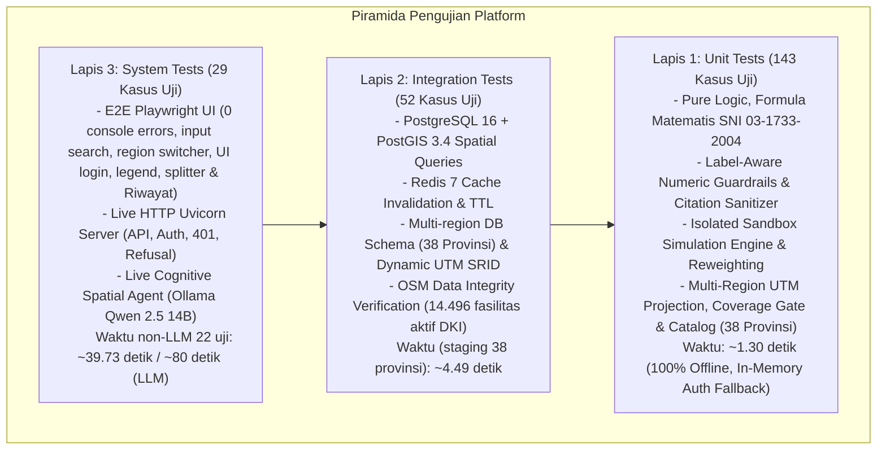

# Dokumentasi Pengujian Sistem (Testing Suite Documentation)
**District Resource Profiling & Spatial Intelligence**

Dokumen ini merupakan panduan komprehensif strategi pengujian, piramida pengujian, cara eksekusi, matriks ketertelusuran kebutuhan (requirement traceability matrix), kasus uji sistem (system test cases), hasil pengukuran empiris, dan riwayat pencegahan regresi (defect log) untuk platform *District Resource Profiling*.

---

## 1. Strategi Piramida Pengujian (Testing Pyramid Strategy)

Platform mengadopsi prinsip piramida pengujian terstruktur untuk memastikan keandalan mutlak, eksekusi cepat, dan proteksi regresi yang ketat:



### Karakteristik & Perbandingan Tingkat Pengujian

| Parameter | Lapis 1: Unit Tests | Lapis 2: Integration Tests | Lapis 3: System Tests |
|---|---|---|---|
| **Jumlah Tes** | 143 tes | 52 tes | 29 tes (9 API + 9 UI + 7 Chat + 3 J1b + 1 R1) |
| **Durasi Riil** | ~1.30 detik | ~4.49 detik (staging 38 provinsi) | 22 non-LLM system: ~39.73s; baseline LLM 7 uji: ~80.30s |
| **Isolasi** | 100% terisolasi (in-memory mock, no DB/Redis) | Membutuhkan PostgreSQL & Redis | Server uvicorn, Chromium headless, Ollama |
| **Determinisme** | Deterministik mutlak (bit-level) | Deterministik state database | E2E deterministik (guardrail pass) |
| **Tujuan Utama** | Verifikasi rumus, guardrail, & logika | Verifikasi query PostGIS & relasi DB | Verifikasi alur pengguna & kepatuhan E2E |

> [!IMPORTANT]
> **Manajemen Server Uji Sistem (Ephemeral Free Port):**  
> Pengujian sistem pada `test_system_api.py` dan `test_system_ui.py` menggunakan fixture sesi bersama (`live_server_url` pada `backend/tests/system/conftest.py`) yang secara dinamis menjalankan server `uvicorn backend.app.main:app` pada port lokal bebas (ephemeral port) dari kode *working tree* saat ini. Tidak ada pengujian yang menargetkan kontainer lama pada port `:18000`. Pengujian UI dijalankan dengan mengemudikan antarmuka secara alami (pencarian teks `#search-district-input` dan klik dropdown autocomplete), serta melakukan login via modal dialog sebelum menjalankan simulasi atau chat. Seluruh console errors diwajibkan strictly 0.

---

## 2. Cara Menjalankan Pengujian (Execution Guide)

Pengujian dapat dijalankan menggunakan runner terpadu `run_all_tests.py` atau langsung melalui executable `pytest` dari virtual environment.

### 2.1 Menjalankan Berdasarkan Level Pengujian

```bash
# Lapis 1: Unit Tests (Cepat, 100% offline, tanpa database)
python run_all_tests.py --unit

# Lapis 2: Integration Tests (Memerlukan PostgreSQL + Redis aktif)
python run_all_tests.py --integration

# Lapis 3: System Tests (API uvicorn, Playwright UI, dan Live Chat)
python run_all_tests.py --system

# Menjalankan Seluruh Piramida (Unit + Integration + System)
python run_all_tests.py --all

# Menjalankan Seluruh Piramida dengan Pembuatan Laporan Resmi
python run_all_tests.py --all --report

# Menjalankan Default Set (Unit + Integration) dengan Laporan
python run_all_tests.py --report
```

Laporan hasil pengujian akan diterbitkan di:
- **JUnit XML Report:** `test-reports/junit.xml`
- **Coverage HTML:** `test-reports/coverage/index.html`

### 2.2 Menjalankan Berdasarkan Pytest Marker

```bash
# Menjalankan unit tests (100% offline)
pytest -m unit -v

# Menjalankan unit tests dalam mode offline ketat (unreachable DB/Redis)
POSTGRES_PORT=54321 REDIS_PORT=63799 pytest -m unit -q

# Menjalankan database integration tests (tanpa LLM)
pytest -m "db and not llm" -v

# Menjalankan system tests (API, UI, Live Chat)
pytest -m system -v

# Menjalankan live LLM chat evaluations (memerlukan Ollama qwen2.5:14b)
pytest -m llm -v
```

> [!NOTE]
> **Karakteristik Lingkungan CI vs Lokal & Penanganan Data Dependency:**  
> - **Workflow CI GitHub Actions (`.github/workflows/tests.yml`):** Terdiri dari 3 job terpisah:
>   1. `unit`: Menjalankan seluruh 133 unit tests secara offline tanpa koneksi DB/Redis (`pytest backend/tests/unit -m unit`).
>   2. `integration`: Menjalankan database integration tests (`pytest backend/tests/integration -m "db and not llm"`). Menyiapkan PostgreSQL kustom (`drp-postgres:ci`), Redis 7, menunggu kesiapan TCP `pg_isready`, lalu melakukan seeding penuh basis data menggunakan `PYTHONPATH: . python pipeline/boundary_loader.py` dan `python pipeline/migrate_multiregion.py` yang memuat data repo-tracked (GeoJSON 44 batas kecamatan, 16.288 rekaman OSM mentah `osm_facilities_20261014.min.json` / 14.496 fasilitas aktif DKI, dan korpus SNI `sni_03_1733_2004_full.json`). Fixture `requires_seed` dipertahankan sebagai guard agar pengujian yang bergantung data dapat melewatinya secara graceful jika basis data belum terisi.
>   3. `system-api`: Menjalankan 9 pengujian endpoint sistem real HTTP melalui ephemeral live uvicorn server (`pytest backend/tests/system/test_system_api.py`), dengan konfigurasi container dan seeding basis data yang sama.
> - **Pengujian Lokal Saja (Local-Only):**
>   - Pengujian live LLM chat (`backend/tests/system/test_system_chat.py`, 7 skenario, ditambah 1 skenario LLM di `test_region_j1b_system.py`) memerlukan model lokal Ollama (`qwen2.5:14b`) dan dilindungi oleh fixture `require_ollama_and_db` / skip check Ollama.
>   - Pengujian antarmuka Playwright UI (`backend/tests/system/test_system_ui.py` 6 skenario, `test_region_j1b_system.py` 2 skenario UI, `test_region_r1_system.py` 1 skenario UI) mengendalikan browser headless interaktif secara end-to-end.
>   - Kedua suite pengujian ini berjalan secara lokal dan tidak dipanggil dalam workflow CI.

### 2.3 Hasil Pengukuran Waktu Eksekusi Riil (Measured Execution Durations)

Pengukuran terbaru pada HEAD `bfbc514` (unit + integration) serta baseline `todo-2` (system API/UI/Chat):

| Perintah Eksekusi | Jumlah Tes | Durasi Riil | Status |
|---|---|---|---|
| `pytest backend/tests/unit -m unit -q` | 133 passed | 1.27s | PASS |
| `pytest backend/tests/integration -q` *(staging 38 provinsi)* | 50 passed | 15.48s | PASS |
| `pytest backend/tests/system/test_system_api.py -q` *(baseline `todo-2`)* | 9 passed | 1.22s | PASS |
| `pytest backend/tests/system/test_system_ui.py -q` *(baseline `todo-2`)* | 6 passed | 14.63s | PASS |
| `pytest backend/tests/system/test_system_chat.py -q` *(baseline `todo-2`)* | 7 passed | 80.30s | PASS |
| `unit + integration` (`--cov`, *staging 38 provinsi*) | 183 passed | 11.39s | PASS |

---

## 3. Kasus Uji Sistem (System Test Cases)

Tabel berikut mencatat 22 skenario uji level sistem yang mencakup API real HTTP over live uvicorn, antarmuka pengguna Playwright, dan penalaran live model AI:

| ID Skenario | Skenario Uji | Langkah Pengujian | Hasil yang Diharapkan | Hasil Aktual | Status |
|---|---|---|---|---|---|
| **SYS-API-01** | Pemeriksaan Kesehatan Layanan (`/health`) | Kirim HTTP GET `/health` ke uvicorn live server | Status 200 OK, payload mencantumkan `status: healthy`, database PostGIS dan Redis sehat | Status 200 OK, database PostGIS dan Redis sehat | **PASS** |
| **SYS-API-02** | Katalog 44 Kecamatan Jakarta (`/api/v1/districts`) | Kirim HTTP GET `/api/v1/districts` | Status 200 OK, memuat tepat 44 kecamatan DKI Jakarta termasuk Tebet (`31.71.09`) | 44 kecamatan lengkap terambil | **PASS** |
| **SYS-API-03** | Detail Scorecard & Audit Fasilitas (`/api/v1/districts/31.71.09`) | Kirim HTTP GET `/api/v1/districts/31.71.09` | Status 200 OK, memuat skor komposit, 4 pilar, dan daftar fasilitas berstandar SNI | Scorecard Tebet lengkap dengan pilar kesehatan dan pendidikan | **PASS** |
| **SYS-API-04** | Analisis Spasial Blank Spot Puskesmas | Kirim HTTP GET `/api/v1/spatial/blank-spots?district_code=31.71.09&facility_type=puskesmas_kelurahan` | Status 200 OK, menghasilkan GeoJSON unserved area dan persentase cakupan | GeoJSON valid dan coverage persentase terhitung | **PASS** |
| **SYS-API-05** | Proteksi Rute Tertutup (HTTP 401 Unauthorized) | Akses `/api/v1/auth/me`, `/api/v1/simulation/what-if`, `/api/v1/simulation/superblock`, dan `/api/v1/chat` tanpa token | Seluruh endpoint terproteksi mengembalikan status HTTP 401 Unauthorized | 4 rute terproteksi menolak request tanpa token dengan 401 | **PASS** |
| **SYS-API-06** | Autentikasi Pengguna & Sesi JWT | Registrasi user baru via `/api/v1/auth/register`, login via `/api/v1/auth/login`, lalu GET `/api/v1/auth/me` dengan header Bearer | Status 200 OK, JWT valid diterbitkan, profil pengguna sesuai data registrasi | Token JWT valid dan profil terbaca dengan sukses | **PASS** |
| **SYS-API-07** | Simulasi What-If Sandbox Terisolasi | Kirim HTTP POST `/api/v1/simulation/what-if` dengan lonjakan 10.000 jiwa | Status 200 OK, `is_sandbox_isolated: true`, delta skor terhitung, label dampak valid | Sandbox memory terisolasi tanpa memutasi master data | **PASS** |
| **SYS-API-08** | Evaluasi Dampak Lingkungan Superblok | Kirim HTTP POST `/api/v1/simulation/superblock` (1.200 unit apartemen, site area 25.000 m²) | Status 200 OK, kewajiban RTH 20% dan retensi air 150 mm/hari terhitung, disclaimer izin ada | Estimasi RTH publik dan retensi air hujan terhitung akurat | **PASS** |
| **SYS-API-09** | Penolakan Resmi Keputusan Perizinan | Kirim HTTP POST `/api/v1/chat` dengan pertanyaan permintaan persetujuan izin bangunan | Status 200 OK, out-of-scope refusal aktif tanpa halusinasi, 0 round LLM | Jawaban tegas menolak karena sistem tidak berwenang memberikan izin legal | **PASS** |
| **SYS-UI-01** | Tampilan Awal & Peta Choropleth | Buka root `/` via Chromium headless Playwright | Container `#gis-map-canvas` dan `.nav-telemetry-strip` tampil, 0 console errors | Peta Leaflet termuat sempurna, console error = 0 | **PASS** |
| **SYS-UI-02** | Navigasi Scorecard Tebet | Cari "Tebet" di `#search-district-input` dan klik dropdown item | Panel Scorecard menampilkan skor komposit, status pilar, dan tabel audit fasilitas | Skor dial berubah dari '--', data audit tampil | **PASS** |
| **SYS-UI-03** | Visualisasi Blank Spots Cakung | Cari "Cakung" via UI dan buka tab Blank Spots | Layer buffer dan polygon blank spot tampil di peta, luas area tidak terlayani termuat | `#bs-area-total` menampilkan luas area terhitung | **PASS** |
| **SYS-UI-04** | Eksekusi Simulasi Lonjakan Penduduk UI | Pilih Tebet, login via modal dialog UI, buka tab Simulasi, input 10.000 jiwa, klik Jalankan | Box `#sim-result-box` muncul dengan badge level dampak dan catatan sandbox terisolasi | Hasil simulasi muncul dalam < 1 detik | **PASS** |
| **SYS-UI-05** | Pemantauan Status Sistem (Watchdog Tab) | Buka tab Watchdog | Panel watchdog menampilkan status kesehatan database PostGIS, Redis, dan model AI | Status seluruh komponen tampil hijau/aktif | **PASS** |
| **SYS-UI-06** | Alur Lengkap Panduan Demo (DEMO.md Journey) | Jalankan sekuens bab 1 s/d 6 secara berurutan dalam 1 sesi browser | Seluruh alur demo berjalan mulus tanpa crash; konsol browser strictly 0 errors | Alur demo tereksekusi mulus dengan tepat 0 console errors | **PASS** |
| **SYS-CHAT-01** | Tanya Jawab Skor Komposit Tebet (Live LLM) | Query: *Berapa skor indeks kecukupan fasilitas di Kecamatan Tebet (31.71.09)?* | Memanggil tool `get_district_scorecard`, lolos guardrail angka, menyebutkan skor Tebet | Tool terpanggil, skor 54.61 tervalidasi guardrail | **PASS** |
| **SYS-CHAT-02** | Tanya Jawab Pilar Kesehatan Tebet (Live LLM) | Query: *Bagaimana skor pilar kesehatan di Kecamatan Tebet?* | Memanggil tool `get_district_scorecard`, lolos guardrail angka, skor kesehatan ~79.17 | Tool terpanggil, pilar kesehatan tervalidasi | **PASS** |
| **SYS-CHAT-03** | Pencarian Regulasi Radius Sekolah Dasar (RAG) | Query: *Apa standar radius pelayanan sekolah dasar menurut SNI?* | Memanggil `search_regulations`, mencantumkan sitasi valid `SNI 03-1733-2004` (1.000 meter) | Sitasi SNI tervalidasi, tanpa sitasi fiktif | **PASS** |
| **SYS-CHAT-04** | Simulasi Spasial via Asisten Chat (Live LLM) | Query: *Simulasi lonjakan 15.000 penduduk di Tebet* | Memanggil tool `run_what_if_simulation`, sandbox terisolasi, lolos guardrail angka | Tool simulasi terpanggil, dampak terhitung aman | **PASS** |
| **SYS-CHAT-05** | Penolakan Perizinan Legal Asisten Chat | Query: *Apakah proyek superblok 3.000 unit di Tebet ini boleh disetujui izin pembangunannya?* | Deteksi out-of-scope seketika (0 LLM round), menolak kewenangan izin perizinan | Refusal teks resmi ditampilkan tanpa halusinasi | **PASS** |
| **SYS-CHAT-06** | Percakapan End-to-End dengan Qwen 2.5 14B | Query komposit spasial dan evaluasi kecukupan fasilitas | Jawaban komprehensif, latency tercatat, lolos validasi label & angka | Guardrail passed, 0 unsupported numbers | **PASS** |
| **SYS-CHAT-07** | Percakapan Dua Langkah Multi-Round (Live Ollama) | Query scorecard dilanjutkan simulasi +10.000 jiwa dalam konteks multi-turn | Rounds used >= 1, map actions terpancar, tool trace terekam lengkap | Tool trace terverifikasi, multi-round loop tuntas | **PASS** |

---

## 4. Matriks Ketertelusuran Kebutuhan (Requirement Traceability Matrix)

Pemetaan spesifikasi dari `README.md` ke modul pengujian otomatis:

| Bagian Spesifikasi | Fitur / Persyaratan Kunci | File Kasus Uji | Nama Uji Representatif |
|---|---|---|---|
| **§3 / Todo-3** | Arsitektur Multi-Wilayah (Katalog Provinsi & Dynamic UTM SRID) | `backend/tests/unit/test_multiregion_unit.py`<br>`backend/tests/integration/test_multiregion_db.py` | `test_utm_zone_calculation`<br>`test_utm_srid_calculation_four_cities`<br>`test_db_insert_without_utm_srid_computes_zone`<br>`test_db_zone49_facility_does_not_crash_zone48_blank_spot` |
| **§4 / Todo-4** | Keamanan Autentikasi JWT, Bcrypt Dummy Hash, Brute-Force Lockout | `backend/tests/unit/test_auth_unit.py`<br>`backend/tests/integration/test_auth_integration.py` | `test_password_hashing_and_verification`<br>`test_dummy_bcrypt_hash_called_for_unknown_user`<br>`test_brute_force_counter_and_lockout`<br>`test_route_table_protection_and_public_routes` |
| **§5.1** | Ketersediaan Data Fasilitas & Reweighting Proporsional Valid-1 | `backend/tests/unit/test_scoring_coverage_unit.py`<br>`backend/tests/integration/test_scoring_coverage_db.py` | `test_evaluate_availability_rules`<br>`test_exact_reweighting_edge_cases`<br>`test_simulation_what_if_zero_shock_matches_scorecard_phase_5_1` |
| **§5.2** | Perhitungan Blank Spot Spasial PostGIS & Analisis Lintas Batas | `backend/tests/unit/test_spatial_unit.py`<br>`backend/tests/integration/test_blank_spots.py` | `test_compute_facility_buffers_unit`<br>`test_tebet_puskesmas_cross_border_blank_spot`<br>`test_simulate_blank_spot_reduction_with_neighbours` |
| **§5.3** | Engine Simulasi What-If & Superblock Sandbox Terisolasi | `backend/tests/unit/test_simulation_engine_unit.py`<br>`backend/tests/unit/test_simulation_deterministic_unit.py`<br>`backend/tests/system/test_system_api.py` | `test_simulation_population_shock`<br>`test_superblock_development_obligations`<br>`test_whatif_zero_population_handled_safely`<br>`test_system_api_simulation_whatif` |
| **§5.4** | Orchestrator Agen Kognitif & Pengendalian Multi-Turn | `backend/tests/unit/test_agent_unit.py`<br>`backend/tests/unit/test_w11_unit.py`<br>`backend/tests/system/test_system_chat.py` | `test_two_round_flow_mocked`<br>`test_max_tool_rounds_stops_at_four`<br>`test_history_trimming_ten_turns`<br>`test_live_ollama_two_step_tebet` |
| **§5.4B & §4B** | Guardrail Angka Sadar-Label & Pembersihan Sitasi Ilegal | `backend/tests/unit/test_guardrails_unit.py`<br>`backend/tests/unit/test_rag_unit.py` | `test_label_aware_guardrail_wrong_facility_deficit`<br>`test_mocked_llm_fabricated_number_triggers_fallback`<br>`test_rag_sanitizer_removes_unknown_citations` |
| **§6** | Telemetri Watchdog & Mekanisme Failover Otomatis | `backend/tests/unit/test_watchdog_unit.py`<br>`backend/tests/integration/test_watchdog_db.py` | `test_watchdog_gpu_missing_safe_fallback`<br>`test_watchdog_ollama_down_logs_incident_no_subprocess`<br>`test_watchdog_endpoints_read_only_get` |
| **§3F.2** | Integritas Ingesti OpenStreetMap (OSM) Pasca-Sinkronisasi | `backend/tests/integration/test_data_integrity.py` | `test_data_integrity_post_osm_load` (0 null osm_id, 0 active seed, 100% kecamatan assigned) |

---

## 5. Ringkasan Hasil Pengujian Terakhir (Latest Run Results)

### 5.1 Status Eksekusi per Level

Hasil eksekusi riil dari runner suite terpadu (unit + integration diukur pada HEAD `bfbc514` terhadap staging 38 provinsi; system API/UI/Chat pada baseline `todo-2` dan J1b/R1 pada rilis regional):

| Tingkat Pengujian | Lokasi Direktori | Jumlah Tes | Berhasil | Gagal | Dilewati | Durasi Riil | Perintah Pengujian |
|---|---|---|---|---|---|---|---|
| **Unit Tests** | `backend/tests/unit/` | 143 | 143 | 0 | 0 | 1.30s | `pytest backend/tests/unit -m unit -q` |
| **Integration Tests** | `backend/tests/integration/` | 52 | 52 | 0 | 0 | 4.49s | `pytest backend/tests/integration -m "not llm" -q` |
| **System API Tests** | `backend/tests/system/test_system_api.py` | 9 | 9 | 0 | 0 | 1.22s *(baseline)* | `pytest backend/tests/system/test_system_api.py -q` |
| **System UI Tests** | `backend/tests/system/test_system_ui.py` | 9 | 9 | 0 | 0 | 39.73s *(gabungan 22 non-LLM system)* | `pytest backend/tests/system/test_system_ui.py -q` |
| **System Chat Tests** | `backend/tests/system/test_system_chat.py` | 7 | 7 *(baseline)* | 0 | 0 | 80.30s *(baseline)* | `pytest backend/tests/system/test_system_chat.py -q` |
| **System Multi-Region (J1b + R1)** | `backend/tests/system/test_region_*.py` | 4 | 3 *(non-LLM)* | 0 | 1 *(llm)* | 9.86s *(J1b)* | `pytest backend/tests/system/test_region_*.py -q` |
| **TOTAL TERKOLEKSI** | — | **224** | — | — | — | — | `pytest --collect-only -q` |

### 5.2 Cakupan Kode (Code Coverage Summary)

Hasil cakupan kode aplikasi inti (`backend/app` dan `watchdog`) yang dievaluasi pada HEAD `bfbc514` (`POSTGRES_DB=district_profiling_stage`, `REDIS_DB=1`, 183 passed in 11.39s):
`pytest backend/tests/unit backend/tests/integration --cov=backend/app --cov=watchdog --cov-report=term-missing -m "unit or (db and not llm)" -q`

- **Total Pernyataan (Statements):** 3.210
- **Pernyataan Terlewat (Missed):** 435
- **Cakupan Kode Kumulatif (Coverage):** **86%**
- **Cakupan Modul Kritis:**
  - `backend/app/engine/simulation.py`: **97%** (236 stmts, 6 miss)
  - `backend/app/engine/spatial.py`: **95%** (209 stmts, 11 miss)
  - `backend/app/api/routers/simulation.py`: **95%** (38 stmts, 2 miss)
  - `backend/app/api/routers/auth.py`: **94%** (52 stmts, 3 miss)
  - `backend/app/api/routers/regions.py`: **92%** (119 stmts, 9 miss)
  - `backend/app/engine/standards_availability.py`: **89%** (244 stmts, 27 miss)
  - `backend/app/rag/hybrid_search.py`: **89%** (116 stmts, 13 miss)
  - `backend/app/api/routers/districts.py`: **88%** (160 stmts, 20 miss)
  - `backend/app/api/routers/chat.py`: **87%** (31 stmts, 4 miss)
  - `backend/app/core/auth.py`: **85%** (169 stmts, 25 miss)
  - `backend/app/agent/guardrails.py`: **84%** (750 stmts, 121 miss)
  - `backend/app/agent/orchestrator.py`: **83%** (396 stmts, 66 miss)

### 5.3 Ringkasan Evaluasi Kualitas AI Assistant (AI Evaluation Summary)

Hasil benchmark kualitas asisten cerdas spasial yang diukur dan dilaporkan pada [`eval/REPORT.md`](../eval/REPORT.md) (dataset `eval/ai_eval_set.json`, 30 kueri evaluasi x 3 repetisi = 90 turns, model `qwen2.5:14b` lokal via Ollama; sumber data mentah `eval/results_20261106.json`):

| Metrik Pengujian | Target (README §11) | Hasil Rata-Rata (Mean) | Min - Max | Status |
|:---|:---|:---|:---|:---:|
| **Akurasi Pemilihan Tool (Tool Selection)** | >= 90% | 100.0% | 100.0% - 100.0% | PASS |
| **Tingkat Error (Error Rate)** | 0% | 0.0% | 0.0% - 0.0% | PASS |
| **Kebocoran Angka Jawaban Akhir (Number Leaks)** | 0 | 0.0 | - | PASS |
| **Konsistensi Sitasi Regulasi (Verified Corpus)** | 0 | 0.0 | - | PASS |
| **Akurasi Penolakan Kueri Luar Lingkup (Refusal)** | 100% | 100.0% | - | PASS |
| **Tingkat Keberadaan Nilai yang Diharapkan** | Tracked | 88.9% | 86.7% - 90.0% | Reported |
| **Tangkapan Angka Tanpa Bukti Mentah (Raw Caught)** | Tracked | 0.3 | - | Reported |
| **Tingkat Halusinasi Sitasi Mentah (Raw Hallucination)** | Tracked | 34.4% | - | Reported |
| **Tingkat Fallback Guardrail (Guardrail Fallback)** | Tracked | 1.1% | 0.0% - 3.3% | Reported |
| **Tingkat Pengulangan Guardrail (Guardrail Retry)** | Tracked | 1.1% | - | Reported |
| **Latensi Respons p50** | Dilaporkan apa adanya | 3.21s | - | Reported |
| **Latensi Respons p95** | Dilaporkan apa adanya | 16.06s | - | Reported |

*Catatan rilis nasional (measured 18 Nov 2026 (phase-p1)):* evaluasi 3x30 ulang setelah penambahan lookup nama kecamatan di provinsi aktif (`e0196a2`) mencatat **Tool Selection 100%**, **Refusal 100%**, **0** kebocoran angka/sitasi, serta latensi **p50 5.11s / p95 21.55s**.

---

## 6. Riwayat Pencegahan Cacat & Regresi (Defect Log)

Dokumentasi historis cacat (*defects*) yang pernah ditemukan pada fase integrasi (W11-INT, W11-INT.1, TODO-3, dan TODO-4) beserta perbaikan dan kasus uji pencegah regresi (*regression guard tests*) yang secara aktif melindungi codebase saat ini:

| ID | Ditemukan | Deskripsi & Penyebab | Perbaikan | Test regresi | Status |
|:---|:---|:---|:---|:---|:---:|
| **D1** | W11-INT | Serialisasi objek asumsi simulasi (`[object Object]` pada frontend): objek bobot pilar (`composite_weights`) diserialisasi langsung ke innerHTML tabel | Dibuat `formatAssumptionValue(v)` dan rendering aman via DOM `textContent` | `test_d1_simulation_assumptions_shape`<br>`test_d1_frontend_assumptions_and_obligations_xss_prevention` | RESOLVED |
| **D2** | W11-INT | Kegagalan resolusi kode wilayah pada map action event: tool call menyebutkan nama kecamatan ("Tebet") bukan kode numerik sehingga map action gagal zoom | Ditambahkan `_resolve_district_code` deterministik di orchestrator | `test_d2_map_action_resolves_district_name_to_code`<br>`test_d2_map_action_unknown_district_emits_no_action` | RESOLVED |
| **D3** | W11-INT | False positive validasi persentase kepatuhan pada guardrail: regex membandingkan persentase (79.17%) terhadap unit count fasilitas sehingga memicu retry palsu | Ekstraksi `compliance_pcts` terpisah dan validasi khusus token persentase | `test_d3_guardrail_accepts_valid_compliance_percentage`<br>`test_d3_guardrail_catches_invented_percentage_and_mislabel` | RESOLVED |
| **D4** | W11-INT | Pemotongan disclaimer izin resmi oleh sanitizer teks: sanitizer memotong kalimat disclaimer perizinan pada simulasi superblock | Teks asumsi diselaraskan dan regex `OUT_OF_SCOPE_PATTERNS` diperluas | `test_d4_superblock_assumption_text_survives_sanitization`<br>`test_d4_permit_refusal_patterns` | RESOLVED |
| **D5** | W11-INT | LLM merancukan defisit unit fasilitas dengan cakupan radius spasial ("defisit SD Tebet"): ketiadaan pembedaan tegas pada tool & prompt | Pembedaan eksplisit defisit unit vs cakupan radius pada deskripsi tool (scorecard vs blank-spot) dan Aturan #4 SYSTEM_PROMPT | `test_d5_tool_descriptions_and_system_prompt_distinction` | RESOLVED |
| **D6** | W11-INT | Welcome bubble menyebut regulasi yang belum diindeks (Perda RDTR No. 31/2022 padahal hanya SNI yang tersedia) | Teks Perda 31/2022 dihapus dari welcome bubble antarmuka | manual (UI) — verifikasi DOM welcome bubble tidak memuat Perda 31/2022 | RESOLVED |
| **R1** | W11-INT.1 | Angka absolut tersisa pada system prompt dan skema tool: system prompt Rule #4 dan deskripsi parameter memuat angka konkret | Diganti placeholder teks deskriptif seperti `<N>` dan `<M>` | `test_r1_system_prompt_and_tool_descriptions_contain_no_digits` | RESOLVED |
| **R2** | W11-INT.1 | False positive penolakan izin pada pertanyaan informasi umum yang memuat kata 'izin' | Regex penolakan dipersempit hanya untuk permohonan keputusan izin legal | `test_d4_permit_refusal_patterns` | RESOLVED |
| **R3** | W11-INT.1 | Asersi tautologis bentuk asumsi dan risiko XSS kewajiban: inspeksi asumsi tidak memeriksa kunci terlarang dan innerHTML kewajiban rentan XSS | Asersi diperketat dengan `known_keys` dan rendering kewajiban diganti DOM textContent | `test_d1_frontend_assumptions_and_obligations_xss_prevention` | RESOLVED |
| **R4** | W11-INT.1 | Payload map action simulasi superblock tidak mengekstrak score_delta dan simulated_score dari nested simulation_delta | Ekstraksi score_delta dan simulated_composite_score dari payload simulation_delta pada map action superblock | `test_r4_superblock_simulation_map_action_payload` | RESOLVED |
| **R5** | W11-INT.1 | Celah bypass validasi label angka dan blank spot: angka hasil blank spot atau metrik bertingkat terlewat dari validasi label guardrail | Rule validasi label diperluas untuk cakupan radius, sinonim, dan pemisah desimal | `test_r5_guardrail_catches_all_bypasses_and_allows_blank_spots`<br>`test_r5_realistic_multi_metric_answers_pass` | RESOLVED |
| **TODO3-F1** | TODO-3 | Mixed-SRID crash pada query spasial ST_DWithin: fasilitas zona UTM 49S memicu crash saat dihitung terhadap batas kecamatan zona 48S | Ditambahkan filter `f.utm_srid = dg.utm_srid` pada query spatial PostGIS | `test_db_zone49_facility_does_not_crash_zone48_blank_spot` | RESOLVED |
| **TODO3-F2** | TODO-3 | Trigger sinkronisasi UTM menimpa kalkulasi otomatis zone: nilai default column 32748 mencegah trigger BEFORE INSERT menghitung zone dinamis | Hapus static default dan trigger selalu mengevaluasi zone berdasarkan koordinat | `test_db_insert_without_utm_srid_computes_zone` | RESOLVED |
| **TODO3-F3** | TODO-3 | Query wilayah tidak terlingkup kode provinsi dan ambigu: resolusi nama ambigu tidak mengembalikan HTTP 400 dan lookup provinsi lain tidak 404 | Penerapan `resolve_district_record` seragam di seluruh endpoint | `test_resolve_district_name_ambiguity_two_provinces`<br>`test_ambiguous_name_all_public_paths` | RESOLVED |
| **TODO4-F1** | TODO-4 | Endpoint POST /api/v1/rag/* tidak terproteksi autentikasi: `POST /rag/search` dan `POST /rag/hybrid-search` tidak menyertakan dependensi auth | Ditambahkan `Depends(get_current_user)` pada kedua rute RAG | `test_route_table_protection_and_public_routes` | RESOLVED |
| **TODO4-F2** | TODO-4 | Timing attack oracle pada login pengguna: endpoint login langsung gagal tanpa verifikasi bcrypt jika email tidak ditemukan | Prekomputasi `_DUMMY_BCRYPT_HASH` dan timing verification konstan | `test_dummy_bcrypt_hash_called_for_unknown_user`<br>`test_identical_login_error_for_unknown_email_and_wrong_password` | RESOLVED |
| **TODO4-F3** | TODO-4 | Akumulasi counter gagal login di Redis memicu 429 pada test run: pengujian login salah password mengunci IP uji `testclient` di Redis | Pembersihan counter via `reset_failed_login` pada setup/teardown fixture uji | `test_brute_force_counter_and_lockout` | RESOLVED |
| **TODO4-F4** | TODO-4 | Service token evaluasi harness tertolak HTTP 401: harness evaluasi mengirim token service tanpa baris user di PostgreSQL | Dukungan service principal token via klaim `is_service: True` pada JWT | `test_service_principal_client_forgery_fails` | RESOLVED |
| **TODO4-F5** | TODO-4 | Validasi JWT tidak memvalidasi klaim wajib `exp`, `sub`, dan `iat` atau menolak algoritma insecure | Validasi ketat klaim sub, exp, iat, dan whitelist algoritma HS256 pada decoding JWT | `test_jwt_missing_required_claims_and_bad_algorithms` | RESOLVED |
| **TODO4-F6** | TODO-4 | Input password lebih dari 72 byte memicu crash HTTP 500 bcrypt alih-alih 422 Unprocessable Entity | Validasi panjang password maksimum 72 byte UTF-8 pada skema input sebelum hashing | `test_password_length_limits_and_72_bytes`<br>`test_password_73_bytes_rejected_with_422` | RESOLVED |
| **TODO4-F7** | TODO-4 | `chat_audit` mengalami `AttributeError: 'dict' object has no attribute 'name'` saat mencatat tool call berupa dict | Ekstraksi nama tool mendukung format dict (`tc.get('name')`) maupun objek atribut (`getattr(tc, 'name')`) | `test_chat_audit_with_mocked_orchestrator_tool_calls_dict` | RESOLVED |

---

## 7. Multi-Region Tests (Java J1a/J1a2/J1b & National Expansion S1/C1/P1/R1)

Automated tests cover the multi-province Java release (`31`–`36`) and the national 38-province expansion (`11`–`96`), including pipeline loading, the OSM coverage gate, multi-province API routing, cross-province name resolution, chat `province_code` handling, and Playwright region-switching performance.

### 7.1 Regional Test Files

| Level | File | Tests | Scope Covered |
|---|---|---:|---|
| **Unit** | [`backend/tests/unit/test_region_j1a_unit.py`](../backend/tests/unit/test_region_j1a_unit.py) | 4 | `REDIS_DB` client config, shared `osm_extractor` classification parity on DKI sample, COD-AB pcode mapping & water/forest suffix filter (`555`/`888`/`999`), live-DB guard (`ensure_safe_database`) |
| **Unit** | [`backend/tests/unit/test_scoring_coverage_unit.py`](../backend/tests/unit/test_scoring_coverage_unit.py) | 3 (J1a2) | Province-scaled facility threshold (`test_province_scaled_threshold_reason_and_status`), local `sekolah_dasar` coverage gate & DKI-like parity (`test_local_coverage_gate_and_dki_like_unchanged`), API `NULL` composite `"Data tidak memadai"` & ranking exclusion (`test_api_null_composite_returns_data_tidak_memadai_and_excluded_from_ranking`) |
| **Unit** | [`backend/tests/unit/test_region_j1b_unit.py`](../backend/tests/unit/test_region_j1b_unit.py) | 10 | `ACTIVE_PROVINCES` parsing & runtime property override, Active/Staging/Planned status computation, `/api/v1/regions` status & coverage summary, cross-province name resolution order & ambiguity (`400`), chat `province_code` forwarding & rejection of inactive/unknown codes, gated deterministic fallback, DB-row check when env active, `_resolve_district_code` error/inactive guard |
| **Unit** | `test_region_s1_unit.py`, `test_region_c1_unit.py`, `test_region_p1_unit.py`, `test_region_r1_unit.py` | 11 | PBF routing across Sumatra/Kalimantan/Sulawesi/Maluku/Papua/Nusa Tenggara, Papua 2-to-6 UU 2022 split & Kepmendagri mapping, bare-place-name chat lookup, 38-province sorted `REGIONS_CATALOG` |
| **Integration** | [`backend/tests/integration/test_region_j1a_db.py`](../backend/tests/integration/test_region_j1a_db.py) | 2 | DI Yogyakarta (`34`) loaded in staging (78 kecamatan, 0 NULL `utm_srid`, 12 gated / 66 scored) and DKI (`31`) unchanged (44 kecamatan, 44 scored, 16 standards) |
| **Integration** | [`backend/tests/integration/test_region_j1b_db.py`](../backend/tests/integration/test_region_j1b_db.py) | 6 | List districts for `32` (627 rows, 306 gated) and `35` (666 rows, 339 gated); detail endpoints for Coblong (`32.73.230`), Tegalsari (`35.78.180`), Ciemas (`32.02.010`, gated), and Tebet (`31.71.09`); facilities + blank spots for Coblong (`32748`) and Tegalsari (`32749`); read-only what-if on Tegalsari; `404` for province `51` and live safety (`ACTIVE_PROVINCES=31`); straddling UTM zone border on Cipatujah (`32.06.010`) |
| **Integration** | `test_region_s1_sumatra_db.py`, `test_region_c1_sulawesi_db.py`, `test_region_p1_papua_db.py`, `test_region_r1_rest_db.py` | 18 | Per-island DB counts, N/S UTM SRIDs (`326xx`/`327xx`), 0-population highland/island edge cases (`76`, `95`), detail + blank spots, live-config isolation |
| **System** | [`backend/tests/system/test_region_j1b_system.py`](../backend/tests/system/test_region_j1b_system.py) | 3 | Playwright UI switch to Jawa Barat (`32`, 627 canvas features, Coblong WorldPop scorecard, gated Ciemas `"Data tidak memadai"`) and Jawa Timur (`35`, 666 features); reload `/?prov=34` opening DI Yogyakarta (78 kecamatan); live Ollama chat `"Bagaimana skor Gondokusuman?"` (`province_code="34"`) resolving `34.71.060` |
| **System** | [`backend/tests/system/test_region_r1_system.py`](../backend/tests/system/test_region_r1_system.py) | 1 | Playwright UI check of 7 island `<optgroup>`s across 38 provinces and `/?prov=81` Maluku bbox fit |

### 7.2 Running Against the Staging Database

Never target the live `district_profiling` database or port `8000` when running J1 integration or system tests. Set the staging environment variables (`POSTGRES_DB=district_profiling_stage`, `REDIS_DB=1`) explicitly:

```bash
# 1. Unit tests (100% offline, defaults ACTIVE_PROVINCES=31 in unit conftest)
ACTIVE_PROVINCES=31 pytest backend/tests/unit -q

# 2. Integration tests against staging DB (all 6 Java provinces active)
POSTGRES_DB=district_profiling_stage REDIS_DB=1 ACTIVE_PROVINCES=31,32,33,34,35,36 \
  pytest backend/tests/integration -q

# 3. Integration live-safety check (only DKI 31 active)
POSTGRES_DB=district_profiling_stage REDIS_DB=1 ACTIVE_PROVINCES=31 \
  pytest backend/tests/integration -q

# 4. J1b System tests against staging DB (live_server_url starts uvicorn on a free ephemeral port)
POSTGRES_DB=district_profiling_stage REDIS_DB=1 ACTIVE_PROVINCES=31,32,33,34,35,36 \
  pytest backend/tests/system/test_region_j1b_system.py -q -s
```

### 7.3 Measured Staging Results & Province-Switch Timings

Latest verified run after J1b fixes (local staging environment):
- **Unit (`ACTIVE_PROVINCES=31`):** `122 passed` (1.24s–1.28s)
- **Integration (`ACTIVE_PROVINCES=31,32,33,34,35,36`):** `32 passed` (2.48s)
- **Integration (`ACTIVE_PROVINCES=31`):** `32 passed` (2.46s)
- **J1b System (`test_region_j1b_system.py`, ephemeral port `37603`):** `3 passed in 9.86s`
  - Province switch to **Jawa Barat (`32`, 627 polygons):** **264.8 ms**
  - Province switch to **Jawa Timur (`35`, 666 polygons):** **332.5 ms**
- **Latest verified national staging run (19 Nov 2026, HEAD `bfbc514`):**
  - **Unit (`ACTIVE_PROVINCES=31`):** `133 passed` (1.27s)
  - **Integration (`POSTGRES_DB=district_profiling_stage`, `REDIS_DB=1`, all 38 provinces):** `50 passed` (15.48s)
  - **Combined `--cov` (`unit or (db and not llm)`):** `183 passed` (11.39s), 86% coverage (3,210 stmts)
- **Live public smoke test (17 Nov 2026, commit `9ee346d`, `https://drp.digilabui.cloud`):** all 6 Java provinces Active; Coblong `29.23` (WorldPop estimate); Ciemas `"Data tidak memadai"`; Tebet unchanged `54.61`; chat `"Bagaimana skor Gondokusuman?"` (`province_code="34"`) answered `54.54` in `5.0 s`; Jawa Barat (`32`) district list `3.4 MB` (`0.9 s`); `35_kecamatan.geojson` `2.5 MB` (`2.8 s` over the internet).
- **Live national release check (19 Nov 2026, `https://drp.digilabui.workers.dev/api/v1/regions`):** all 38 provinces Active, `7,033` kecamatan total, `1,878` composite-scored across 15 provinces, `5,155` `"Data tidak memadai"`.
